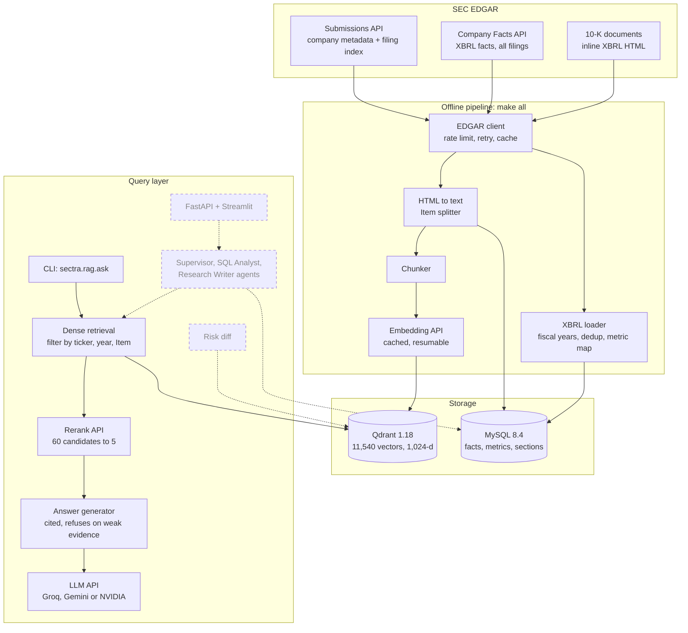
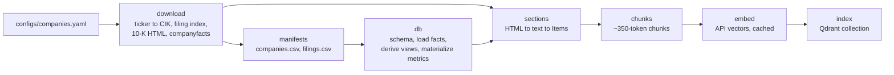

# **S.E.C.T.R.A**
###### *Securities & Exchange Commission Tracking, Retrieval & Analysis*

**A research system over SEC EDGAR 10-K filings. Numeric questions are answered from a validated financial database, textual questions with cited retrieval-augmented generation (RAG), and (in progress) hybrid questions with both. Every claim traces to a source.**

| | |
|---|---|
| Corpus | 20 companies, 80 annual reports, 534,026 XBRL facts, 11,540 text chunks |
| Retrieval | **95.1% Recall@5** on 82 paraphrased questions searched across the whole corpus (84.1% before reranking) |
| Status | Phases 0–3 complete · Phase 4 (evaluation) retrieval done, answer faithfulness pending · agents, risk diffing and UI planned |

---

## Contents

1. [Overview](#1-overview)
2. [Results](#2-results)
3. [Architecture](#3-architecture)
4. [Documentation](#4-documentation)
5. [Running the project](#5-running-the-project)
6. [Roadmap](#6-roadmap)
7. [Repository structure](#7-repository-structure)
8. [Tech stack](#8-tech-stack)
9. [Limitations](#9-limitations)

---

## 1. Overview

### The problem

Analysts spend much of their time on two tasks:

- **Searching long filings** (often 100+ pages) for a specific risk, policy, or explanation.
- **Connecting numbers to narrative**: *"Revenue grew 30%, but what did management say drove it?"*

A general-purpose chatbot handles both poorly. It can invent figures, it does arithmetic unreliably, and it cannot point to the exact filing section a claim came from.

### The approach

S.E.C.T.R.A gives each kind of question to the tool that is good at it:

| Need | Source of truth | Mechanism | Status |
|---|---|---|---|
| Exact figures (revenue, net income, assets…) | XBRL facts in **MySQL**, normalized into 15 canonical metrics | SQL over `financial_metrics` | ✅ database built and validated · SQL agent in Phase 5 |
| Explanations, risks, strategy | Filing text in **Qdrant**, split by 10-K Item | Dense retrieval → reranking → cited generation | ✅ built and measured |
| Questions needing both | Both | Supervisor agent routes and merges | Phase 6 |

**Design principle: the LLM never supplies facts from memory.** Every figure must come from a database row and every textual claim from a retrieved passage. When the evidence is missing, the system says *"not found"* instead of guessing.

### Example

```text
$ python -m sectra.rag.ask "What export restrictions affect NVIDIA's sales to China?" --ticker NVDA --year 2025
[backend: groq / openai/gpt-oss-120b | retriever: rerank, min_score 0.042]

In its FY 2025 10-K NVIDIA explains that U.S. export-control rules now require licenses for virtually
all of its high-performance products shipped to China (including Hong Kong and Macau).

* August 2022 – the U.S. government announced licensing requirements for exports of the A100 and H100
  integrated circuits, DGX systems or any boards that incorporate those chips to China and Russia [2].
* July 2023 – an additional licensing requirement was added for a subset of A100 and H100 products
  destined for certain customers and other regions, including some Middle-East countries [1][2][4].
  ...

Sources:
 *[1] NVDA 10-K FY2025 | Item 1A Risk Factors | Risks Related to Regulatory, Legal, Our Stock and Other Matters  (score 0.179)
       0001045810-25-000023_1A_049  https://www.sec.gov/Archives/edgar/data/1045810/000104581025000023/nvda-20250126.htm
 *[2] NVDA 10-K FY2025 | Item 1 Business | Government Regulations  (score 0.142)
       0001045810-25-000023_1_023  https://www.sec.gov/Archives/edgar/data/1045810/000104581025000023/nvda-20250126.htm
  ...
[openai/gpt-oss-120b | 1768 in / 817 out tokens | 2.6s]

$ python -m sectra.rag.ask "What is Tesla's battery supply strategy?"
Not found in the indexed filings.
(reason: best match too weak (score 0.04 < 0.042))
```

`*` marks passages the answer actually cites. Each citation resolves to a chunk ID, an accession number, a 10-K Item, and the SEC URL of the original document. Tesla is not in the corpus, so the second question is refused before any LLM call.

---

## 2. Results

### Pipeline

| Component | Measure | Result |
|---|---|---|
| Data acquisition | 10-K filings downloaded and verified (SHA-256) | **80 / 80** |
| XBRL load | Fact rows loaded vs. source count | **534,026 / 534,026** |
| Fiscal-year derivation | Downloaded filings labelled | **80 / 80**; SEC's own `fy` field was wrong for 4 NVIDIA filings |
| Metric normalization | FY2025 coverage of core metrics (revenue, net income, EPS, assets, equity, operating cash flow) | **20 / 20 companies** |
| Metric validation | Values compared by hand with printed statements | **10 / 10 match** after one mapping fix (Chevron revenue) |
| Section extraction | Filings with Items 1A **and** 7 correctly extracted | **76 / 80 (95.0%)**; all 4 failures have one known cause |
| Chunking | Chunks produced | **11,540** (median 319 tokens, max 458) |
| Tests | Unit tests, no network | **64 passing** |

### Retrieval

82 answerable questions, worded differently from the passage that answers them, searched across all 11,540 chunks with no filters:

| Retriever | Recall@1 | Recall@5 | MRR@10 |
|---|---|---|---|
| Dense search | 57.3% | 84.1% | 0.682 |
| **Dense search + reranking** | **84.1%** | **95.1%** | **0.890** |

With the company and fiscal year given as filters, reranked Recall@5 is 98.8%.

What was learned on the way, with the full numbers in [docs/05-evaluation.md](docs/05-evaluation.md):

- **The embedding model was the bottleneck.** Replacing a small local model with a hosted 8B model raised dense Recall@5 from 24.4% to 84.1%.
- **Keyword search looked best until the questions were paraphrased.** BM25 scored 82.9% on LLM-written questions that reused the passage's wording and 22.0% on paraphrases of the same questions.
- **Hybrid search stopped helping.** Fusing BM25 with the stronger dense ranking lowered Recall@5 from 84.1% to 61.0%, so BM25 was removed.
- **A similarity score is a weak refusal signal.** A threshold that refuses no real question stops 5 of 15 unanswerable ones; the rest are left to the model's `NOT_FOUND` rule.

Not measured yet: whether generated answers are supported by the passages they cite.

---

## 3. Architecture

Solid boxes are built; dashed boxes are planned.



Every model (embedding, reranking, generation) is reached through a hosted API and chosen in `configs/`; no model name appears in the code. The step-by-step query flow is in [docs/04-retrieval-and-answers.md](docs/04-retrieval-and-answers.md).

### Offline pipeline

Every stage is idempotent: re-running it produces the same result without duplicates.



| `make` target | What it does | Typical time |
|---|---|---|
| `up` / `down` | Start or stop MySQL and Qdrant | |
| `download` | Fetch filing indexes, 10-K documents and XBRL (cached), write manifests and `docs/dataset.md` | ~70 s cold, ~1 s cached |
| `db` | `db-schema` → `db-load` (manifests, 534K facts, metric map) → `db-derive` (views, materialized metrics) | ~45 s |
| `sections` | Split all 80 filings into Items, write files + `filing_sections` + parse report | ~15 s |
| `chunks` | Section-aware chunking → `chunks.jsonl` | ~30 s |
| `embed` | Embed new or changed chunks through the embedding API | ~20 min first run, seconds after |
| `index` | Upsert into Qdrant, delete stale points | ~20 s |
| `all` | Everything above from `download` to `index` | |
| `test` | Unit tests | <1 s |
| `eval` | Retrieval evaluation on both question sets | a few minutes |
| `threshold` | Refusal-threshold sweep from the saved results | <1 s |

---

## 4. Documentation

| Document | Contents |
|---|---|
| [docs/01-data-acquisition.md](docs/01-data-acquisition.md) | SEC, EDGAR and XBRL background; dataset scope; the download client; on-disk layout |
| [docs/02-financial-database.md](docs/02-financial-database.md) | Why raw XBRL cannot be queried directly; schema; fiscal-year derivation; the metric map; validation |
| [docs/03-filing-text.md](docs/03-filing-text.md) | HTML to clean text; splitting a 10-K into Items; chunking rules |
| [docs/04-retrieval-and-answers.md](docs/04-retrieval-and-answers.md) | Embeddings, vector store, reranking, LLM layer, citation checks, the two refusal layers |
| [docs/05-evaluation.md](docs/05-evaluation.md) | How the question sets were built; every retrieval variant measured; threshold calibration; what the numbers do not show |
| [docs/findings.md](docs/findings.md) | Problems found in the data and the pipeline, with evidence and fixes; changes to the original plan |
| [docs/roadmap.md](docs/roadmap.md) | Checklist for the rest of Phase 4 and Phases 5–9 |
| [docs/dataset.md](docs/dataset.md) | Generated per-company dataset report |
| [docs/validation.md](docs/validation.md) | Hand checks of database values against printed financial statements |
| [eval/results/experiments.md](eval/results/experiments.md) | Archived numbers for every retrieval experiment, including removed variants |

---

## 5. Running the project

### Prerequisites

Python 3.11+, Docker, ~1 GB free disk, an SEC-compliant `User-Agent`, and API keys for the embedding/reranking provider and at least one LLM provider. Developed on an 8 GB Apple-Silicon Mac; no model runs locally.

### Setup

```bash
git clone https://github.com/iamnitishsah/S.E.C.T.R.A.git
cd S.E.C.T.R.A
python3 -m venv .venv && source .venv/bin/activate
pip install -e ".[dev]"
cp .env.example .env          # fill in the values below
make up                       # MySQL 8.4 + Qdrant 1.18.2
make all                      # download -> db -> sections -> chunks -> embed -> index
make test
```

The first `make all` downloads ~313 MB from SEC and embeds 11,540 chunks through the embedding API (about 20 minutes on a free endpoint; it checkpoints and resumes if interrupted). Every later run is incremental.

### Configuration

**`.env`**

| Variable | Purpose |
|---|---|
| `SEC_USER_AGENT` | `"Your Name you@email.com"`, required by SEC |
| `MYSQL_ROOT_PASSWORD`, `MYSQL_DATABASE`, `MYSQL_USER`, `MYSQL_PASSWORD`, `MYSQL_HOST`, `MYSQL_PORT` | Database |
| `QDRANT_URL` | `http://localhost:6333` |
| `NVIDIA_API_KEY` | Embedding and reranking APIs (and the `nvidia` LLM backend) |
| `GROQ_API_KEY`, `GEMINI_API_KEY` | LLM providers |
| `LLM_BACKEND` | `groq`, `gemini` or `nvidia` |

**`configs/`**

| File | Contents |
|---|---|
| `companies.yaml` | Tickers by sector; forms; filings per company |
| `retrieval.yaml` | Indexed Items; chunking; embedding API (URL, model, key variable, dimensions); vector store; rerank API and candidate count; which retriever `ask` uses and its refusal threshold |
| `llm.yaml` | LLM backends (base URL, key variable, model); generation settings (`temperature: 0`, `max_tokens: 2000`) |

Switching a model or provider is a config change. Changing the embedding model or its dimensions requires `make embed index`, and the refusal thresholds should be recalibrated with `make eval threshold`.

### Usage

```bash
# Ask the filings
python -m sectra.rag.ask "What does NVIDIA say drove its data center revenue growth?" --ticker NVDA --year 2026 --item 7
python -m sectra.rag.ask "..." --backend gemini --show-passages
python -m sectra.rag.ask "..." --retriever dense          # skip reranking
python -m sectra.llm.base groq                            # list models available to your key

# Measure retrieval
make eval
make threshold

# Query the financial database (MySQL shell)
docker compose exec mysql sh -c 'MYSQL_PWD="$MYSQL_PASSWORD" mysql -u"$MYSQL_USER" "$MYSQL_DATABASE"'
```
```sql
SELECT fiscal_year, ROUND(value / 1e9, 2) AS net_income_bn, source_accession
FROM financial_metrics
WHERE ticker = 'NVDA' AND canonical_metric = 'net_income'
ORDER BY fiscal_year DESC LIMIT 5;
```

The Qdrant dashboard is at http://localhost:6333/dashboard.

---

## 6. Roadmap

| Phase | Scope | Status |
|---|---|---|
| 0–1 | Data acquisition; XBRL → MySQL; fiscal years; canonical metrics; validation | ✅ |
| 2 | 10-K HTML → clean text → Items | ✅ |
| 3 | Chunking, embeddings, vector store, cited answers with refusal | ✅ |
| 4 | Evaluation and retrieval upgrades | Retrieval and refusal threshold ✅ · answer faithfulness and generator comparison pending |
| 5 | SQL Analyst agent: validated read-only text-to-SQL, deterministic ratio tools | Planned |
| 6 | Multi-agent orchestration: supervisor, routing, grounding checks | Planned |
| 7 | Risk diffing between two fiscal years of Item 1A | Planned |
| 8 | Injection filter, red-team set, FastAPI, Streamlit | Planned |
| 9 | Failure analysis, demo, release | Planned |

The full checklist is in [docs/roadmap.md](docs/roadmap.md).

---

## 7. Repository structure

```text
S.E.C.T.R.A/
├── README.md
├── Makefile                     # make = help; pipeline stages, eval and threshold as targets
├── docker-compose.yml           # MySQL 8.4, Qdrant 1.18.2
├── pyproject.toml
├── .env.example
│
├── configs/
│   ├── companies.yaml           # tickers by sector, forms, filings per company
│   ├── retrieval.yaml           # chunking, embedding API, vector store, rerank API, answering
│   └── llm.yaml                 # LLM backends and generation settings
│
├── sql/
│   ├── schema.sql               # tables
│   ├── views.sql                # fiscal years, annual facts, metric view
│   ├── post_load.sql            # filings.fiscal_year + materialized financial_metrics
│   └── metric_map.csv           # XBRL tag -> canonical metric (priorities, overrides)
│
├── src/sectra/
│   ├── ingestion/
│   │   ├── edgar_client.py      # rate-limited, cached SEC client
│   │   ├── company_resolver.py  # ticker -> CIK
│   │   ├── filing_downloader.py # filing index -> 10-K selection -> download
│   │   ├── download.py          # orchestration + manifests
│   │   ├── dataset_report.py    # docs/dataset.md
│   │   ├── load_manifests.py    # companies + filings -> MySQL
│   │   ├── xbrl_loader.py       # companyfacts -> financial_facts
│   │   ├── load_metric_map.py   # metric_map.csv -> MySQL
│   │   ├── chunker.py           # sections -> chunks.jsonl
│   │   ├── embed_chunks.py      # chunks -> cached vectors (checkpointed, resumable)
│   │   └── index_chunks.py      # vectors -> Qdrant
│   ├── parsing/
│   │   ├── html_text.py         # 10-K HTML -> clean text + anchors
│   │   ├── section_splitter.py  # text -> Items
│   │   └── build_sections.py    # all filings -> files + filing_sections + report
│   ├── storage/
│   │   ├── mysql.py             # SQLAlchemy engine from .env
│   │   └── vector_store.py      # Qdrant collection, upsert, filtered search
│   ├── retrieval/
│   │   ├── embedder.py          # embedding API client
│   │   ├── dense.py             # search_filings(): filtered vector search
│   │   ├── reranker.py          # rerank API client + reranked retriever
│   │   └── factory.py           # retriever by name: dense | rerank
│   ├── llm/
│   │   └── base.py              # provider-agnostic LLM client
│   ├── rag/
│   │   ├── answer.py            # retrieve -> prompt -> cite -> validate
│   │   └── ask.py               # CLI + run log
│   └── evaluation/
│       ├── qa_set.py            # generate, review, build and paraphrase the question sets
│       ├── retrieval_eval.py    # Recall@k, MRR, paired comparison
│       └── threshold.py         # refusal-threshold sweep
│
├── tests/                       # 64 tests; fakes instead of network calls
├── eval/
│   ├── datasets/                # candidates, unanswerable, retrieval_qa, retrieval_qa_paraphrased
│   └── results/                 # per-question results, experiments.md, section_parse_report.csv
├── docs/                        # see Section 4
└── data/                        # git-ignored; rebuilt by `make all`
```

---

## 8. Tech stack

| Layer | Choice | Status |
|---|---|---|
| Language | Python 3.12 | ✅ |
| Relational store | MySQL 8.4 (SQLAlchemy + PyMySQL) | ✅ |
| HTML parsing | lxml | ✅ |
| Token counting | Hugging Face `transformers` tokenizer (chunk sizing only) | ✅ |
| Embeddings | Hosted embedding API, 1,024-d (currently `nvidia/nemotron-3.5-embed-8b`) | ✅ |
| Vector store | Qdrant 1.18.2 (`qdrant-client` 1.18.0) | ✅ |
| Reranker | Hosted cross-encoder API (currently `nvidia/nemotron-3.5-rerank-8b`) | ✅ |
| LLM | Groq `openai/gpt-oss-120b` (default), Gemini, NVIDIA; `openai` SDK as OpenAI-compatible client | ✅ |
| Evaluation | Custom scripts: Recall@k, MRR, exact sign test, threshold sweep | ✅ |
| Tests | pytest | ✅ |
| Packaging | Docker Compose, `pyproject.toml`, Makefile | ✅ |
| Faithfulness judge | Claim-level LLM judge | Phase 4 |
| SQL safety | `sqlglot` validator, read-only role | Phase 5 |
| Agents | LangGraph | Phase 6 |
| API / UI | FastAPI, Streamlit | Phase 8 |

---

## 9. Limitations

- **Coverage:** 20 companies, 4 annual 10-Ks each. Numeric history reaches back to ~2009, but text covers only the downloaded filings.
- **Intel** (4 filings) has no extracted sections; its cross-reference format is not supported.
- **Metric normalization** is validated on a sample, not exhaustively; rare tags may be unmapped. Gaps are reported as NULL.
- **Per-share history** is not split-adjusted across filings.
- **No segment-level numbers** in SQL; they exist only in filing text.
- **Retrieval is measured on one kind of question:** 82 single-passage questions written and paraphrased by LLMs. Multi-passage, cross-company and cross-year questions are not measured.
- **Answer faithfulness is not measured yet.** Citation checks confirm that cited passages exist, not that they support each claim.
- **Out-of-corpus questions** (a company or year that is not indexed) are mostly caught by the model's refusal, not by retrieval scores.
- **Hosted APIs:** free endpoints are rate-limited, a content-safety filter refuses a few passages, models are not fully deterministic, and model names change as providers retire them.

---

*This project is for educational and portfolio purposes. It is not financial, investment, or legal advice. Filing data comes from the U.S. SEC's public EDGAR system; users are responsible for following the SEC's fair-access guidelines.*