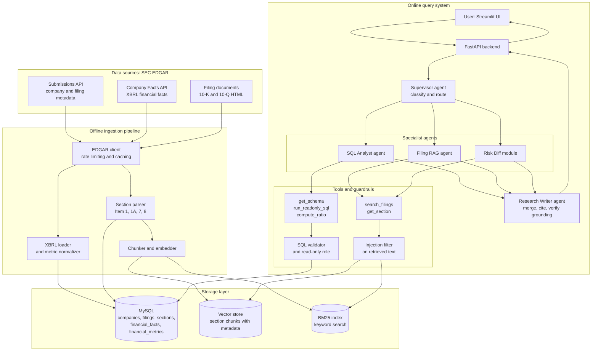
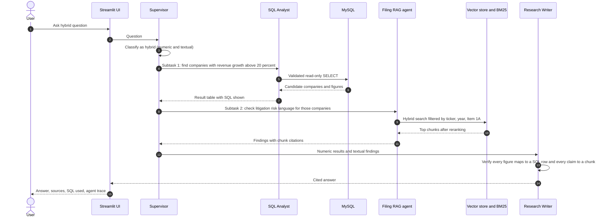
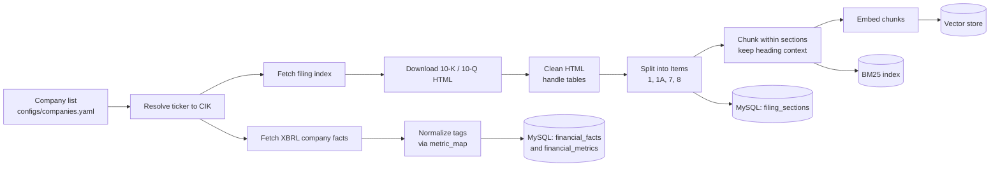

# **S.E.C.T.R.A**
###### *Securities & Exchange Commission Tracking, Retrieval & Analysis*

**A multi-agent research system over SEC EDGAR filings that answers numeric questions with SQL, textual questions with retrieval-augmented generation (RAG), and hybrid questions with both, with every claim traced to a source.**

---

## Table of Contents

1. [Overview](#1-overview)
2. [Background: SEC, EDGAR, and Filings](#2-background-sec-edgar-and-filings)
3. [Dataset](#3-dataset)
4. [System Architecture](#4-system-architecture)
5. [Core Features](#5-core-features)
6. [Tech Stack](#6-tech-stack)
7. [Repository Structure](#7-repository-structure)
8. [Phase-wise Roadmap](#8-phase-wise-roadmap)
9. [Evaluation Plan](#9-evaluation-plan)
10. [Safety and Guardrails](#10-safety-and-guardrails)
11. [Quickstart (planned)](#11-quickstart-planned)
12. [Scope and Limitations](#12-scope-and-limitations)
13. [Disclaimer](#13-disclaimer)

---

## 1. Overview

### The problem

Financial analysts spend a large share of their time on two tasks:

- **Searching long filings** (often 100+ pages) for a specific risk, policy, or explanation.
- **Connecting numbers to narrative**, for example: "Revenue grew 30%, but what did management say drove it?"

A general-purpose chatbot handles both poorly. It can hallucinate figures, it cannot reliably do arithmetic, and it cannot cite the exact filing section a claim came from.

### The idea

S.E.C.T.R.A splits the work by what each tool is good at:

| Need | Source of truth | Mechanism |
|---|---|---|
| Exact figures (revenue, margins, growth) | Structured XBRL data in **MySQL** | Text-to-SQL and deterministic ratio tools |
| Explanations, risks, strategy | Filing text in a **vector store** | Hybrid retrieval (BM25 + dense) with reranking |
| Questions needing both | Both | A **supervisor agent** routes and merges |

**Design principle: the LLM never supplies numbers from memory.** Every figure in an answer must trace to a SQL row, and every textual claim must trace to a retrieved chunk. If evidence is missing, the system says so instead of guessing.

### Example questions

| Type | Question | Route |
|---|---|---|
| Numeric | "What was Nvidia's operating margin for each of the last 5 fiscal years?" | SQL agent |
| Textual | "What supply chain risks did AMD highlight in its latest 10-K?" | RAG agent |
| Hybrid | "Which semiconductor companies grew revenue by more than 20% but added new litigation risk language?" | SQL agent, then RAG agent, then writer |
| Comparative | "How did Tesla's risk factors change between FY2023 and FY2024?" | Risk-diff feature |
| Out of scope | "Should I buy this stock?" | Refused with explanation |

---

## 2. Background: SEC, EDGAR, and Filings

**SEC (U.S. Securities and Exchange Commission)** is the U.S. regulator of securities markets. Any company with publicly traded shares in the U.S. must disclose its finances, risks, and material events on a fixed schedule so that investors have access to the same information.

**EDGAR (Electronic Data Gathering, Analysis, and Retrieval)** is the SEC's public database where these disclosures are filed. It is free to use and offers programmatic access through `data.sec.gov`.

### Filing types used in this project

| Form | Description | Frequency |
|---|---|---|
| **10-K** | Annual report: business description, risks, audited financials | Yearly |
| **10-Q** | Quarterly report: condensed, unaudited financials | Three per year |
| **8-K** | Current report for material events (out of scope for the first version) | As events occur |

### Key sections of a 10-K

| Item | Title | Why it matters here |
|---|---|---|
| Item 1 | Business | What the company does, segments, competition |
| **Item 1A** | **Risk Factors** | Long, text-rich, ideal for RAG and year-over-year diffing |
| **Item 7** | **MD&A** (Management's Discussion and Analysis) | Management's explanation of why numbers moved |
| Item 8 | Financial Statements and Notes | Source of the XBRL numbers |

### XBRL

**XBRL (eXtensible Business Reporting Language)** is a tagging standard in which companies mark up their reported numbers with standardized tags such as `Revenues`, `NetIncomeLoss`, and `Assets`. This is what makes clean, machine-readable financial data available alongside the unstructured text.

---

## 3. Dataset

### Sources

| # | Source | Content | Format | Destination |
|---|---|---|---|---|
| 1 | Submissions API (`data.sec.gov/submissions`) | Company metadata and filing lists | JSON | MySQL |
| 2 | Company Facts API (`data.sec.gov/api/xbrl/companyfacts`) | XBRL financial facts per company | JSON | MySQL |
| 3 | Filing documents (`sec.gov/Archives/...`) | 10-K and 10-Q main documents | HTML | Parsed to sections, then vector store |

The SEC's bulk "Financial Statement Data Sets" are an optional alternative to the Company Facts API for loading structured data at scale.

### Scope for the first version

- **Companies:** 50 to 100 large U.S.-listed companies across 4 to 5 sectors (for example technology, semiconductors, banks, healthcare, energy), defined in `configs/companies.yaml`.
- **Filings:** 10-Ks for the last 3 to 5 fiscal years. 10-Qs are added once the 10-K pipeline is stable.
- **Expected scale:** several hundred filings, tens of thousands of section chunks, and millions of XBRL fact rows.

### Relational schema (MySQL)

```text
companies          cik (PK), ticker, name, sic, sic_description, exchange, fiscal_year_end
filings            accession_no (PK), cik (FK), form_type, filing_date, period_of_report,
                   fiscal_year, fiscal_period, primary_doc_url, local_path
filing_sections    section_id (PK), accession_no (FK), item_code, item_title,
                   char_start, char_end, text_path
financial_facts    fact_id (PK), cik (FK), taxonomy, tag, unit, value, period_start,
                   period_end, fiscal_year, fiscal_period, form, accession_no, filed_date
metric_map         tag, canonical_metric, priority      -- maps many XBRL tags to one metric
financial_metrics  (VIEW) cik, fiscal_year, fiscal_period, canonical_metric, value
```

**Why `metric_map` exists:** different companies report the same concept under different XBRL tags (for example revenue appears as `Revenues`, `RevenueFromContractWithCustomerExcludingAssessedTax`, or `SalesRevenueNet`). A normalization layer lets the SQL agent query a stable set of canonical metrics instead of raw tags.

### Vector store payload

Each chunk is stored with metadata so retrieval can be filtered precisely:

```json
{
  "chunk_id": "0000320193-24-000123_1A_007",
  "text": "...",
  "ticker": "AAPL",
  "cik": "0000320193",
  "form_type": "10-K",
  "fiscal_year": 2024,
  "item_code": "1A",
  "accession_no": "0000320193-24-000123",
  "source_url": "https://www.sec.gov/Archives/..."
}
```

### Data access rules

- Send a descriptive `User-Agent` header containing your name and email, as required by the SEC.
- Stay under the SEC's rate limit (10 requests per second).
- Cache all downloads locally so that nothing is fetched twice.

---

## 4. System Architecture

### 4.1 System overview



### 4.2 Query flow for a hybrid question

Example: *"Which semiconductor companies grew revenue by more than 20% but added new litigation risk language?"*



### 4.3 Agent responsibilities

| Component | Responsibility | Tools |
|---|---|---|
| **Supervisor** | Classifies the question (numeric, textual, hybrid, comparative, out of scope), decomposes it, routes subtasks | Routing only, no data access |
| **SQL Analyst** | Converts numeric questions to SQL, runs them safely, returns tables | `get_schema`, `run_readonly_sql`, `compute_ratio(ticker, metric, years)` |
| **Filing RAG agent** | Retrieves and summarizes relevant filing passages | `search_filings(query, ticker, year, item)`, `get_section(accession_no, item)` |
| **Risk Diff module** | Compares the same section across two fiscal years and reports additions, removals, rewordings | `get_section`, embedding-based paragraph matcher |
| **Research Writer** | Merges outputs into one answer, attaches citations, runs a grounding check | None |

### 4.4 Ingestion pipeline



---

## 5. Core Features

1. **Question routing across SQL and RAG.** The supervisor decides which source answers which part of a question, and splits hybrid questions into subtasks.
2. **Section-aware chunking.** Filings are split by Item (1A, 7, and so on) first, then chunked inside each section. Chunks keep their section heading and metadata. This beats fixed-size windows on long, structured documents.
3. **Hybrid retrieval with reranking.** BM25 plus dense embeddings, fused and reranked by a cross-encoder. Financial text contains many exact terms and numbers where pure embedding search is weak.
4. **Deterministic numbers.** Figures come from SQL and ratio tools. The LLM never computes margins or growth rates itself.
5. **Citations everywhere.** Answers link each claim to a filing, section, and chunk, or to the SQL query and rows used.
6. **Refusal on weak evidence.** If retrieval confidence is low or SQL returns nothing, the system says "not found in the indexed filings."
7. **Year-over-year risk diffing.** Compare Item 1A across fiscal years and produce a structured report of added, removed, and reworded risks.
8. **Swappable generator.** A config flag (`LLM_BACKEND=api|local`) switches between a hosted API model and a local open-source model, so the two can be compared on faithfulness, cost, and latency.
9. **Transparent agent trace.** The UI shows which agent ran, which SQL executed, and which chunks were retrieved.

---

## 6. Tech Stack

| Layer | Choice | Notes |
|---|---|---|
| Language | Python 3.11+ | |
| Relational store | MySQL 8 | Financial facts and metadata |
| Vector store | Qdrant (Chroma as a lightweight alternative) | Metadata-filtered search |
| Keyword search | BM25 (`rank_bm25` or Qdrant sparse vectors) | |
| Embeddings | `bge-base-en-v1.5` (open source) | Runs locally or on Colab/Kaggle |
| Reranker | `bge-reranker-base` | Cross-encoder |
| LLM | Hosted API model and a local open-source model (Llama 3.1 8B, Qwen2.5 7B, or Mistral 7B via Ollama) | Behind a common interface |
| Agent orchestration | LangGraph | Supervisor pattern with shared state |
| HTML parsing | BeautifulSoup / lxml | Custom Item splitter |
| Backend | FastAPI | |
| UI | Streamlit | Shows agent trace and SQL |
| Evaluation | RAGAS plus custom scripts | |
| Packaging | Docker Compose, `pyproject.toml` | |

---

## 7. Repository Structure

```text
S.E.C.T.R.A/
├── README.md
├── LICENSE
├── pyproject.toml
├── Makefile
├── docker-compose.yml            # MySQL, Qdrant, API, UI
├── .env.example                  # SEC_USER_AGENT, LLM_BACKEND, API keys, DB creds
│
├── configs/
│   ├── companies.yaml            # tickers in scope, grouped by sector
│   ├── retrieval.yaml            # chunk size, top-k, fusion weights, reranker settings
│   └── llm.yaml                  # backend selection and model names
│
├── data/                         # gitignored
│   ├── raw/
│   │   ├── filings/              # downloaded 10-K / 10-Q HTML
│   │   └── xbrl/                 # companyfacts JSON
│   ├── processed/
│   │   ├── sections/             # parsed Items as text / JSONL
│   │   └── chunks/               # chunked text with metadata
│   └── cache/                    # HTTP response cache
│
├── sql/
│   ├── schema.sql                # tables
│   ├── views.sql                 # financial_metrics view
│   ├── metric_map.csv            # XBRL tag to canonical metric mapping
│   └── roles.sql                 # read-only DB user for the SQL agent
│
├── src/sectra/
│   ├── config.py
│   ├── ingestion/
│   │   ├── edgar_client.py       # rate-limited, cached SEC client
│   │   ├── company_resolver.py   # ticker to CIK
│   │   ├── xbrl_loader.py        # facts to MySQL
│   │   ├── filing_downloader.py
│   │   ├── section_parser.py     # HTML to Items
│   │   └── chunker.py
│   ├── storage/
│   │   ├── mysql.py
│   │   └── vector_store.py
│   ├── retrieval/
│   │   ├── bm25.py
│   │   ├── dense.py
│   │   ├── hybrid.py             # score fusion
│   │   └── reranker.py
│   ├── llm/
│   │   ├── base.py               # common interface
│   │   ├── api_backend.py
│   │   └── local_backend.py
│   ├── tools/
│   │   ├── sql_tools.py          # get_schema, run_readonly_sql
│   │   ├── ratio_tools.py        # compute_ratio and derived metrics
│   │   └── search_tools.py       # search_filings, get_section
│   ├── agents/
│   │   ├── state.py              # shared graph state
│   │   ├── supervisor.py
│   │   ├── sql_analyst.py
│   │   ├── filing_rag.py
│   │   ├── writer.py
│   │   └── graph.py              # LangGraph wiring
│   ├── features/
│   │   └── risk_diff.py          # year-over-year section comparison
│   ├── guardrails/
│   │   ├── sql_validator.py      # SELECT-only, LIMIT, timeout, table allowlist
│   │   ├── injection_filter.py   # treat retrieved text as untrusted
│   │   └── grounding.py          # verify claims map to rows or chunks
│   └── api/
│       ├── main.py               # FastAPI app
│       └── schemas.py
│
├── app/
│   └── streamlit_app.py
│
├── eval/
│   ├── datasets/
│   │   ├── retrieval_qa.jsonl    # question to gold section/chunk
│   │   ├── text_to_sql.jsonl     # question to gold SQL
│   │   ├── routing.jsonl         # question to expected route
│   │   └── red_team.jsonl        # injection and unsafe-SQL attempts
│   ├── run_retrieval_eval.py
│   ├── run_sql_eval.py
│   ├── run_routing_eval.py
│   ├── run_faithfulness_eval.py
│   └── results/                  # saved metric tables
│
├── notebooks/                    # exploration: EDGAR API, parsing experiments
├── tests/
│   ├── test_section_parser.py
│   ├── test_sql_validator.py
│   ├── test_ratio_tools.py
│   └── test_hybrid_retrieval.py
└── docs/
    ├── architecture.md
    └── images/
```

---

## 8. Phase-wise Roadmap

Phases are ordered by dependency. Each phase has an exit criterion, and the next phase begins only when it is met.

### Phase 0: Foundations

**Goal:** a working skeleton and a clear understanding of the data.

- [ ] Read a sample 10-K end to end (Items 1A, 7, 8) and inspect the matching `companyfacts` JSON.
- [ ] Choose the company list and sectors; write `configs/companies.yaml`.
- [ ] Create the repo, `pyproject.toml`, `.env.example`, and linting and test setup.
- [ ] Write `docker-compose.yml` with MySQL and Qdrant.
- [ ] Build `edgar_client.py` with `User-Agent`, rate limiting, retries, and disk caching.

**Exit criterion:** `docker compose up` starts both databases, and the client can fetch and cache a company's filing index.

### Phase 1: Structured data (XBRL to MySQL)

**Goal:** a queryable financial database.

- [ ] Design and apply `schema.sql`.
- [ ] Implement `company_resolver.py` (ticker to CIK) and load `companies` and `filings`.
- [ ] Implement `xbrl_loader.py` to load `financial_facts`.
- [ ] Build `metric_map.csv` for core metrics (revenue, gross profit, operating income, net income, EPS, total assets, total liabilities, equity, operating cash flow, capex, R&D).
- [ ] Create the `financial_metrics` view and handle duplicate and restated facts.
- [ ] Validate against a few companies by hand (compare to the filing's printed statements).

**Exit criterion:** simple SQL queries (for example five-year revenue for ten companies) return values that match the filings.

### Phase 2: Filing text ingestion

**Goal:** clean, section-level text for every filing in scope. This is the hardest parsing phase.

- [ ] Implement `filing_downloader.py` for 10-K main documents.
- [ ] Clean HTML (remove boilerplate, handle tables, normalize whitespace).
- [ ] Implement `section_parser.py` to split into Items 1, 1A, 7, and 8, handling table-of-contents false matches and format variations across companies.
- [ ] Store sections on disk and register them in `filing_sections`.
- [ ] Write parser tests on a varied sample of filings and log parse failures for review.

**Exit criterion:** Items 1A and 7 are extracted correctly for at least 95% of filings in scope, and failures are listed and understood.

### Phase 3: RAG baseline

**Goal:** an end-to-end retrieve-and-generate pipeline with citations.

- [ ] Implement `chunker.py` (section-aware, heading context preserved, overlap).
- [ ] Embed chunks and index them in Qdrant with metadata.
- [ ] Implement dense retrieval with metadata filters (ticker, year, item).
- [ ] Implement the common `llm/base.py` interface with an API backend and a local backend.
- [ ] Build the answer prompt requiring citations and a "not found" path.
- [ ] Add a command-line interface to ask questions.

**Exit criterion:** the baseline answers textual questions with citations pointing to real chunks.

### Phase 4: Evaluation and retrieval upgrades

**Goal:** measurable quality and documented improvement.

- [ ] Hand-label 50 to 100 retrieval questions with gold sections or chunks.
- [ ] Implement `run_retrieval_eval.py` (recall@k, MRR) and record the baseline.
- [ ] Add BM25 and score fusion (`hybrid.py`).
- [ ] Add the cross-encoder reranker.
- [ ] Compare chunk sizes and chunking strategies.
- [ ] Add faithfulness evaluation (RAGAS and a custom LLM-as-judge) and compare API vs local generators.
- [ ] Save all results as tables in `eval/results/`.

**Exit criterion:** a results table showing each retrieval variant against the baseline, with the best configuration selected.

### Phase 5: SQL Analyst agent

**Goal:** reliable text-to-SQL over the financial tables.

- [ ] Implement `get_schema` (with column descriptions and canonical metric list) and `run_readonly_sql`.
- [ ] Implement `sql_validator.py`: SELECT-only, table allowlist, enforced `LIMIT`, query timeout.
- [ ] Create a read-only MySQL role in `roles.sql`.
- [ ] Implement `ratio_tools.py` for margins, growth rates, and other derived metrics.
- [ ] Write the SQL agent with a schema-aware prompt, error feedback, and retry.
- [ ] Hand-write 40 to 50 questions with gold SQL; implement `run_sql_eval.py` (execution accuracy).

**Exit criterion:** execution accuracy is measured, failure cases are categorized, and no unsafe query passes the validator.

### Phase 6: Multi-agent orchestration

**Goal:** one interface that handles numeric, textual, and hybrid questions.

- [ ] Define shared graph state (`state.py`).
- [ ] Implement the supervisor: classification, decomposition, routing, out-of-scope handling.
- [ ] Wire the SQL Analyst and Filing RAG agent into the LangGraph in `graph.py`.
- [ ] Implement the Research Writer with citation formatting.
- [ ] Add `grounding.py` to verify that figures map to SQL rows and claims map to chunks.
- [ ] Build the routing eval set and `run_routing_eval.py`.

**Exit criterion:** hybrid questions return merged, cited answers, and routing accuracy is measured.

### Phase 7: Risk diffing

**Goal:** the headline feature.

- [ ] Split Item 1A into individual risk paragraphs or headings.
- [ ] Match paragraphs across two fiscal years by embedding similarity.
- [ ] Classify each as unchanged, reworded, added, or removed (LLM on matched pairs only).
- [ ] Produce a structured report with citations to both filings.
- [ ] Spot-check the output by hand on several companies and record accuracy notes.

**Exit criterion:** given a ticker and two years, the system produces a diff report that matches a manual read on spot-checked examples.

### Phase 8: Safety, API, and UI

**Goal:** a usable and defensible application.

- [ ] Add `injection_filter.py` and treat all retrieved text as untrusted input.
- [ ] Build `red_team.jsonl` (prompt injection inside filing text, attempts at unsafe SQL, out-of-scope requests) and measure the block rate.
- [ ] Build the FastAPI backend (`/ask`, `/risk-diff`, `/health`).
- [ ] Build the Streamlit UI with the answer, citations, executed SQL, and agent trace.
- [ ] Finalize Docker Compose so the full system starts with one command.

**Exit criterion:** the full system runs from a clean clone, and red-team results are recorded.

### Phase 9: Documentation and release

**Goal:** make the work legible to others.

- [ ] Finalize this README with real results tables, final architecture diagram, and screenshots.
- [ ] Write `docs/architecture.md` explaining design decisions and trade-offs.
- [ ] Write a failure analysis: where parsing, retrieval, SQL, and routing still go wrong.
- [ ] Record a short demo of a numeric, a textual, a hybrid, and a risk-diff query.
- [ ] Deploy a live demo if hosting allows.

**Exit criterion:** someone unfamiliar with the project can clone it, run it, and understand its results.

---

## 9. Evaluation Plan

All numbers below are to be filled in as phases complete.

| Component | Metric | Dataset | Result |
|---|---|---|---|
| Section parsing | % of filings with Items 1A and 7 extracted correctly | Parser test sample | TBD |
| Retrieval | Recall@5, Recall@10, MRR | `retrieval_qa.jsonl` | TBD |
| Retrieval variants | Baseline vs hybrid vs hybrid + rerank | `retrieval_qa.jsonl` | TBD |
| Generation | Faithfulness, answer correctness | RAGAS and LLM-as-judge | TBD |
| Generator comparison | API model vs local model (quality, latency, cost) | Same questions | TBD |
| Text-to-SQL | Execution accuracy | `text_to_sql.jsonl` | TBD |
| Routing | Route accuracy | `routing.jsonl` | TBD |
| Safety | Block rate on injection and unsafe-SQL attempts | `red_team.jsonl` | TBD |
| Risk diff | Agreement with manual review on spot-checked companies | Manual sample | TBD |

---

## 10. Safety and Guardrails

- **Read-only database access.** The SQL agent connects with a MySQL role that has `SELECT` privileges only.
- **SQL validation.** Queries are checked against a table allowlist, restricted to `SELECT`, given an enforced `LIMIT`, and run with a timeout.
- **Numbers from data, not memory.** Figures in answers must map to SQL rows or retrieved chunks; the grounding check flags anything unsupported.
- **Refusal on weak evidence.** Low retrieval confidence or empty results produce an explicit "not found."
- **Untrusted retrieved text.** Filing text is treated as data, never as instructions. Retrieved content is delimited in prompts and screened for instruction-like patterns.
- **Scope control.** Investment advice and predictions are declined; the system reports what filings say, not what to buy.

---

## 11. Quickstart (planned)

> These commands describe the intended workflow and will work once Phases 0 to 3 are complete.

```bash
# 1. Clone and configure
git clone https://github.com/<your-username>/S.E.C.T.R.A.git
cd S.E.C.T.R.A
cp .env.example .env
# Set SEC_USER_AGENT="Your Name your.email@example.com", LLM_BACKEND, and credentials

# 2. Start services
docker compose up -d mysql qdrant

# 3. Ingest data (company list is read from configs/companies.yaml)
make ingest-structured     # XBRL facts to MySQL
make ingest-filings        # download, parse, chunk, embed, index

# 4. Run evaluations
make eval

# 5. Launch the app
docker compose up api ui
# UI at http://localhost:8501
```

---

## 12. Scope and Limitations

**In scope for the first version**

- 10-K filings (10-Q after the 10-K pipeline is stable)
- A fixed, pre-selected company list
- Read-only question answering, comparison, and risk diffing

**Out of scope for now**

- Agents that write to or modify the database, including automatic onboarding of new companies. This is deferred until the core system is solid.
- 8-K event filings, earnings call transcripts, and market price data
- Non-U.S. filers' home-country regulatory filings
- Forecasting, trading signals, or investment recommendations

**Known challenges**

- Filing HTML varies widely across companies, so section parsing needs ongoing handling of edge cases.
- XBRL tag usage differs by company and over time, so metric normalization will be imperfect for rarely used tags.
- Tables inside filings are hard to chunk meaningfully; structured numbers are taken from XBRL instead of table text.

---

## 13. Disclaimer

This project is for educational and portfolio purposes. It is not financial, investment, or legal advice. Filing data is sourced from the U.S. SEC's public EDGAR system; users are responsible for following the SEC's fair access guidelines.
