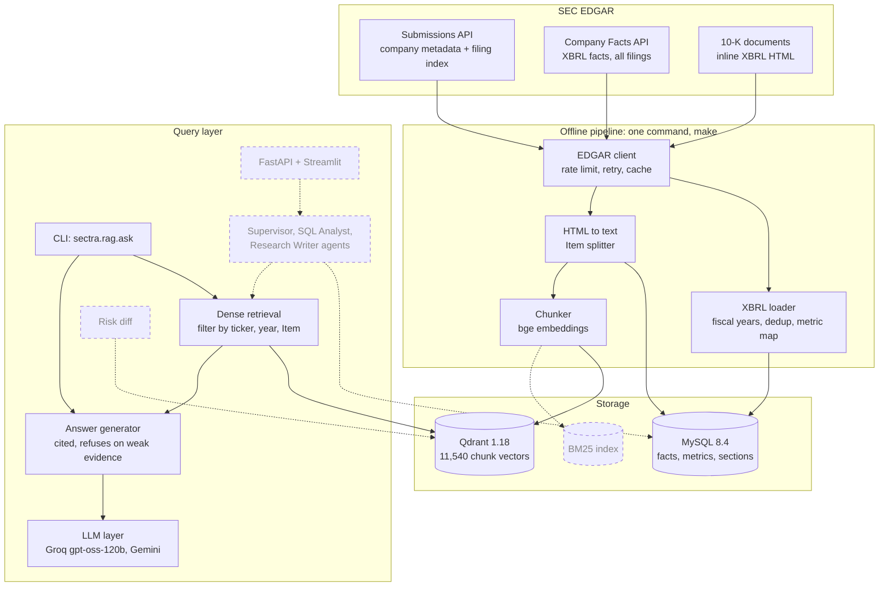
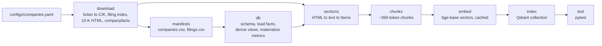
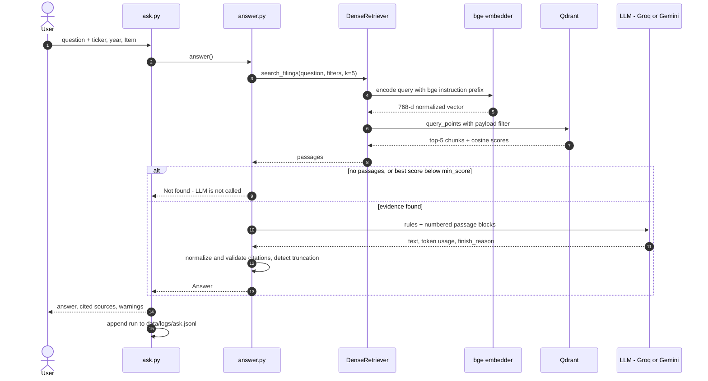
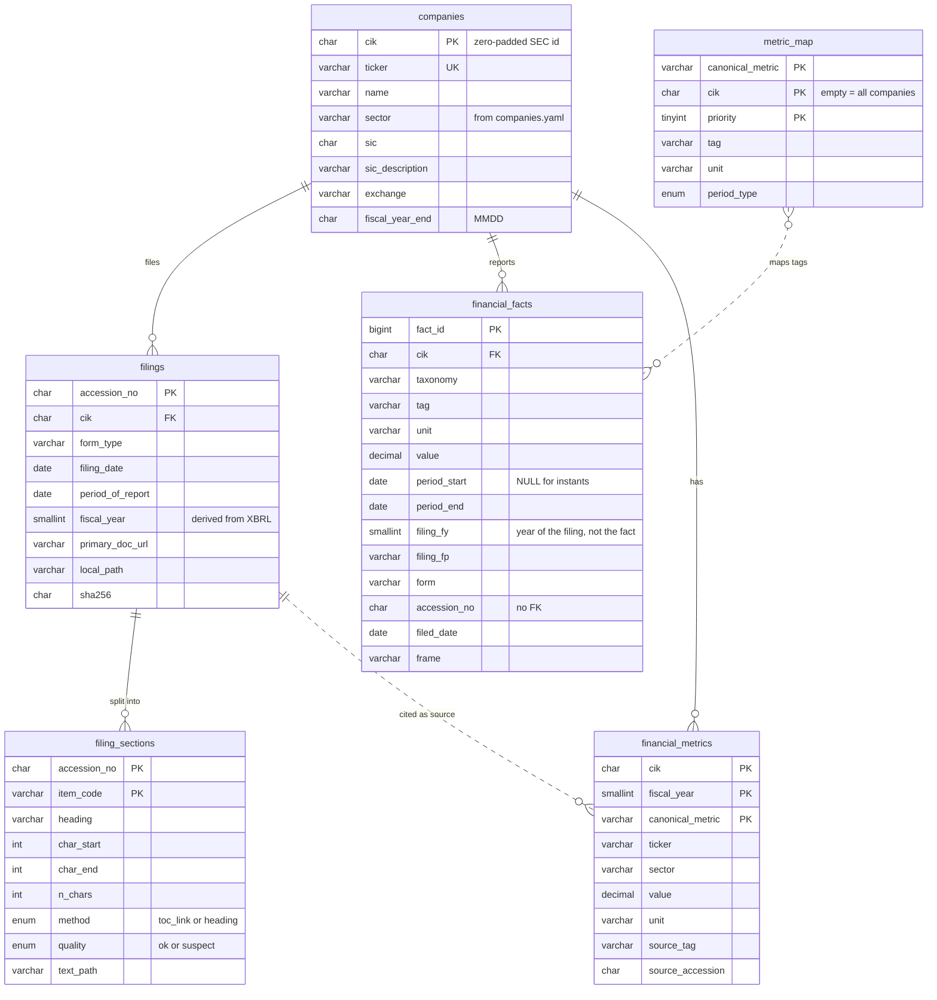
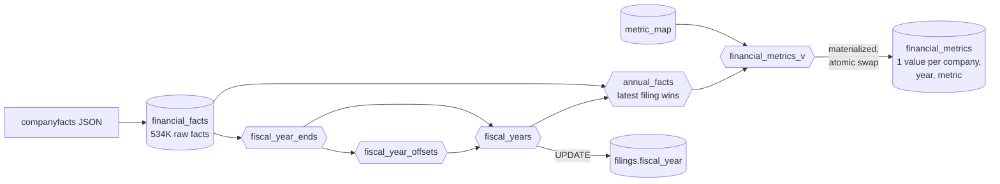
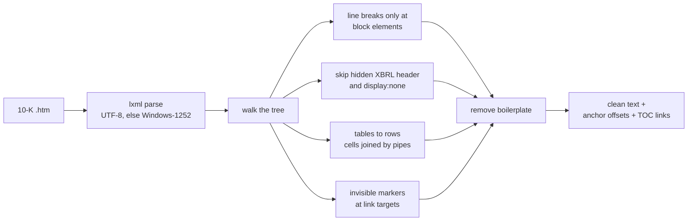
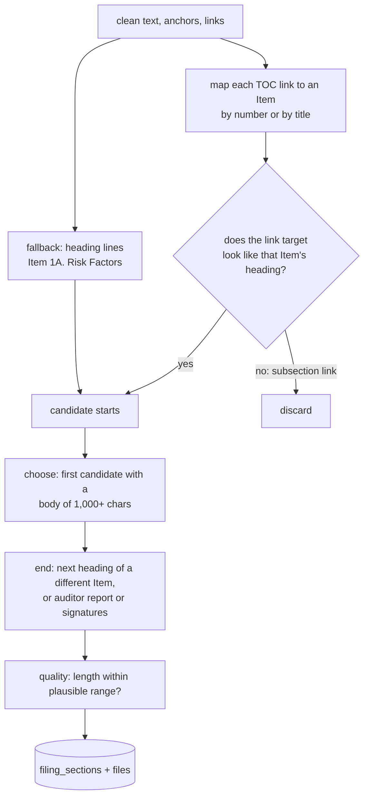
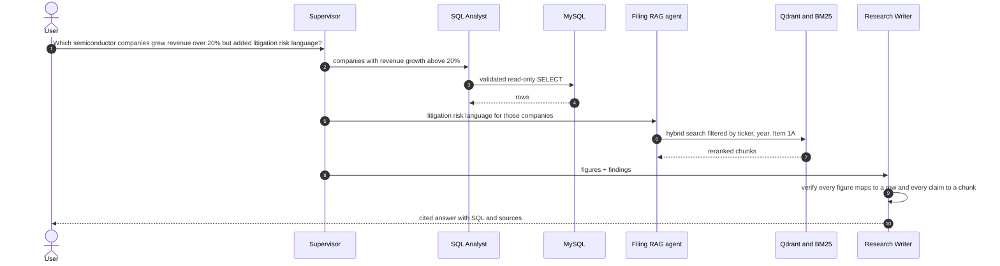

# **S.E.C.T.R.A**
###### *Securities & Exchange Commission Tracking, Retrieval & Analysis*

**A research system over SEC EDGAR 10-K filings that answers numeric questions from a validated financial database, textual questions with cited retrieval-augmented generation (RAG), and (in progress) hybrid questions with both. Every claim traces to a source.**

---

## Table of Contents

1. [Overview](#1-overview)
2. [Results at a Glance](#2-results-at-a-glance)
3. [Background: SEC, EDGAR, XBRL](#3-background-sec-edgar-xbrl)
4. [Architecture](#4-architecture)
5. [Dataset](#5-dataset)
6. [Structured Data: XBRL → MySQL](#6-structured-data-xbrl--mysql)
7. [Filing Text: HTML → Sections](#7-filing-text-html--sections)
8. [RAG Baseline: Chunks → Retrieval → Cited Answers](#8-rag-baseline-chunks--retrieval--cited-answers)
9. [Findings from the Data](#9-findings-from-the-data)
10. [Running the Project](#10-running-the-project)
11. [Roadmap (Phases 4–9)](#11-roadmap-phases-49)
12. [Repository Structure](#12-repository-structure)
13. [Tech Stack](#13-tech-stack)
14. [Limitations](#14-limitations)
15. [Disclaimer](#15-disclaimer)

---

## 1. Overview

### The problem

Analysts spend much of their time on two tasks:

- **Searching long filings** (often 100+ pages) for a specific risk, policy, or explanation.
- **Connecting numbers to narrative**: *"Revenue grew 30%, but what did management say drove it?"*

A general-purpose chatbot handles both poorly. It can invent figures, it does arithmetic unreliably, and it cannot point to the exact filing section a claim came from.

### The approach

S.E.C.T.R.A gives each kind of question to the tool that is good at it:

| Need | Source of truth | Mechanism | Status |
|---|---|---|---|
| Exact figures (revenue, net income, assets…) | XBRL facts in **MySQL**, normalized into 15 canonical metrics | SQL over `financial_metrics` | ✅ database built and validated · SQL agent in Phase 5 |
| Explanations, risks, strategy | Filing text in **Qdrant**, split by 10-K Item | Filtered dense retrieval + cited generation | ✅ baseline built · hybrid search and reranking in Phase 4 |
| Questions needing both | Both | Supervisor agent routes and merges | Phase 6 |

**Design principle: the LLM never supplies facts from memory.** Every figure must come from a database row and every textual claim from a retrieved passage. When the evidence is missing, the system says *"not found"* instead of guessing.

### Example

```text
$ python -m sectra.rag.ask "What supply chain and manufacturing risks does AMD describe?" --ticker AMD --year 2025 --item 1A

- Dependence on third-party manufacturers and subcontractors gives AMD limited control over delivery
  schedules, yields, cycle times, quality assurance, pricing, inventory management and part availability [1].
- If manufacturers cannot meet AMD's near-term or long-term requirements, AMD may have to allocate reduced
  quantities among customers, lose sales, and suffer material adverse effects [2].
- Specific reliance on TSMC for 7 nm-plus wafers means any inability by TSMC to produce sufficient wafers
  would materially harm AMD's business [2].
  ...

Sources:
 *[1] AMD 10-K FY2025 | Item 1A Risk Factors | Operational and Technology Risks  (score 0.733)
       0000002488-26-000018_1A_021  https://www.sec.gov/Archives/edgar/data/2488/000000248826000018/amd-20251227.htm
 *[2] AMD 10-K FY2025 | Item 1A Risk Factors | Operational and Technology Risks  (score 0.729)
       0000002488-26-000018_1A_019  https://www.sec.gov/Archives/edgar/data/2488/000000248826000018/amd-20251227.htm
  ...
[openai/gpt-oss-120b | 1867 in / 664 out tokens | 3.1s]
```

`*` marks passages the answer actually cites. Each citation resolves to a chunk ID, an accession number, a 10-K Item, and the SEC URL of the original document.

---

## 2. Results at a Glance

| Component | Measure | Result |
|---|---|---|
| Data acquisition | 10-K filings downloaded and verified (SHA-256) | **80 / 80**; full rebuild from scratch in ~70 s |
| XBRL load | Fact rows loaded vs. source count | **534,026 / 534,026** |
| Fiscal-year derivation | Downloaded filings labelled | **80 / 80**; SEC's own `fy` field was wrong for 4 NVIDIA filings |
| Metric normalization | FY2025 coverage of core metrics (revenue, net income, EPS, assets, equity, operating cash flow) | **20 / 20 companies** |
| Metric validation | Values compared by hand with printed statements | **10 / 10 match** after one mapping fix (Chevron revenue) |
| Section extraction | Filings with Items 1A **and** 7 correctly extracted | **76 / 80 (95.0%)**; all 4 failures have one known cause |
| Chunking | Chunks within the embedding model's 512-token limit | **11,540 / 11,540** (median 319 tokens, max 458) |
| Tests | Unit tests (parsing, chunking, answer pipeline) | **48 passing** |
| Retrieval quality | Recall@k, MRR | *Phase 4* |
| Answer faithfulness | LLM-as-judge, claim by claim | *Phase 4* |

---

## 3. Background: SEC, EDGAR, XBRL

**SEC** (U.S. Securities and Exchange Commission) regulates U.S. securities markets. Publicly traded companies must disclose their finances, risks, and material events on a fixed schedule.

**EDGAR** is the SEC's public filing database, with free programmatic access through `data.sec.gov`.

| Form | Content | Frequency | Used here |
|---|---|---|---|
| **10-K** | Annual report: business, risks, audited financials | Yearly | ✅ |
| 10-Q | Quarterly report, unaudited | Three per year | Facts only (via XBRL) |
| 8-K | Material events | As they occur | ❌ |

### Structure of a 10-K

| Part | Item | Content | Indexed for RAG |
|---|---|---|---|
| I | **1** | Business | ✅ |
| I | **1A** | **Risk Factors** | ✅ (also the basis of risk diffing) |
| I | **1C** | Cybersecurity (required for fiscal years ending on/after 15 Dec 2023) | ✅ |
| I | **3** | Legal Proceedings | ✅ |
| II | **7** | **MD&A**: management's explanation of the numbers | ✅ |
| II | **7A** | Market risk | ✅ |
| II | 8 | Financial statements | ❌ (numbers come from XBRL) |

### XBRL

**XBRL** (eXtensible Business Reporting Language) tags every reported number with a standard concept such as `us-gaap:Revenues` or `us-gaap:NetIncomeLoss`. Modern 10-Ks use **inline XBRL**: the tags are embedded in the HTML document itself. The SEC extracts them into one JSON file per company (*companyfacts*), covering every filing back to about 2009. That JSON is **structured but not clean**, and Section 6 explains why.

---

## 4. Architecture

### 4.1 System overview

Solid boxes are built; dashed boxes are planned.



### 4.2 Offline pipeline

Every stage is idempotent: re-running it produces the same result without duplicates.



| `make` target | What it does | Typical time |
|---|---|---|
| `download` | Fetch filing indexes, 10-K documents and XBRL (cached), write manifests and `docs/dataset.md` | ~70 s cold, ~1 s cached |
| `db` | `db-schema` → `db-load` (manifests, 534K facts, metric map) → `db-derive` (views, materialized metrics) | ~45 s |
| `sections` | Split all 80 filings into Items, write files + `filing_sections` + parse report | ~15 s |
| `chunks` | Section-aware chunking → `chunks.jsonl` | ~30 s |
| `embed` | Embed new or changed chunks only | ~15 min first run (MPS), seconds after |
| `index` | Upsert into Qdrant, delete stale points | ~12 s |
| `test` | Unit tests | <1 s |
| *(default)* | All of the above, in order | |

### 4.3 Query flow (RAG baseline)



---

## 5. Dataset

### 5.1 Scope

| | |
|---|---|
| Companies | **20** across **4 sectors**: technology (AAPL, MSFT, GOOGL, AMZN, META), semiconductors (NVDA, AMD, INTC, QCOM, AVGO), healthcare (JNJ, PFE, MRK, ABBV, LLY), energy (CVX, COP, MPC, SLB, EOG) |
| Filings | Latest **4** annual 10-Ks per company = **80** filings, periods 2022-10-30 to 2026-09-27 |
| Documents | 313 MB of 10-K HTML |
| XBRL | **534,026** fact rows (**221,215** after SEC frame dedup), 12,229 distinct concepts, history back to ~2009 |
| Text | 1,784 extracted sections → **11,540** chunks |

Banks are configured but disabled: they report revenue under different XBRL concepts and have no gross-profit line, so they are added after the metric map is extended. The full per-company table is generated into [`docs/dataset.md`](docs/dataset.md).

### 5.2 Sources

| Source | Content | Destination |
|---|---|---|
| `www.sec.gov/files/company_tickers.json` | Ticker → CIK map (~10,400 companies) | `data/cache/` |
| `data.sec.gov/submissions/CIK##########.json` | Company profile + complete filing index | `companies` table, filing selection |
| `data.sec.gov/api/xbrl/companyfacts/CIK##########.json` | Every XBRL fact the company has filed | `financial_facts` |
| `www.sec.gov/Archives/edgar/data/{cik}/{accession}/{doc}` | The 10-K documents | Section extraction |

### 5.3 Acquisition (`src/sectra/ingestion/`)

| Module | Responsibility | Key engineering decisions |
|---|---|---|
| `edgar_client.py` | All HTTP traffic to SEC | Declared `User-Agent` (SEC requirement) · throttled to **8 req/s** (limit is 10) · exponential backoff on 429/5xx/timeouts · **no retry on 403** (bad User-Agent or block: retrying only makes it worse) · writes to `<file>.part` then renames, so a crash never leaves a half-file that looks cached · the downloaded files *are* the cache |
| `company_resolver.py` | Ticker → zero-padded CIK | Rejects non-string tickers (PyYAML reads a bare `ON` as `True`) · reports all unknown tickers at once |
| `filing_downloader.py` | Choose and fetch 10-Ks | Converts SEC's columnar index to rows · **generator** over index pages, so older pages are fetched only when needed · exact form match (`10-K`, never `10-K/A`) · archive URLs use the unpadded CIK and the accession number without dashes |
| `download.py` | Orchestration + manifests | One failing company is logged and skipped; a 403 aborts the run · manifests drop companies removed from config · `filings.csv` stores a **SHA-256** per document |
| `dataset_report.py` | `docs/dataset.md` | Reports raw *and* deduplicated XBRL counts |

### 5.4 On-disk layout (`data/`, git-ignored)

```text
data/
├── cache/company_tickers.json
├── raw/                                  # exactly what SEC sent; never modified
│   ├── submissions/CIK##########.json
│   ├── filings/<TICKER>/<period>_10-K_<accession>.htm
│   ├── xbrl/CIK##########.json
│   └── manifest/{companies.csv, filings.csv, last_run.json}
├── processed/                            # everything derived; rebuildable from raw/
│   ├── text/<TICKER>/<accession>.txt               full clean text
│   ├── sections/<TICKER>/<accession>/<item>.txt    one file per Item
│   ├── chunks/chunks.jsonl
│   └── embeddings/BAAI__bge-base-en-v1.5/{vectors.npy, chunk_ids.json, keys.json}
└── logs/ask.jsonl                        # every question asked, for evaluation
```

---

## 6. Structured Data: XBRL → MySQL

### 6.1 Why the raw JSON cannot be queried directly

| Problem in companyfacts | Evidence |
|---|---|
| The same value appears 2–3 times | Every 10-K repeats the previous two years as comparatives: Apple's FY2024 revenue ($391.035B) appears in three filings |
| `fy` describes the **filing**, not the value | Those three copies carry `fy` = 2024, 2025 and 2026 |
| `fy` is sometimes simply wrong | NVIDIA FY2011–FY2014 labelled one year early |
| `frame` is a calendar label | NVIDIA's FY2026 (Feb 2025–Jan 2026) is framed `CY2025` |
| Annual, quarterly, year-to-date and point-in-time values are mixed | 119K annual, 113K quarterly, 98K YTD, 202K instants |
| Many tags for one concept, and one tag with different meanings | Revenue appears under 4+ tags; Chevron's `Revenues` includes other income, ConocoPhillips' does not |

### 6.2 Schema



| Decision | Reason |
|---|---|
| **CIK is the primary key, not the ticker** | Tickers move between entities (see `XOM` in Section 9) |
| `DECIMAL(30,6)`, never `FLOAT` | Binary floats cannot represent money exactly; JSON is parsed with `Decimal` end to end |
| `period_start` nullable | Balance-sheet items are point-in-time; income items span a period |
| `filing_fy` / `filing_fp` naming | Makes it impossible to mistake the filing's year for the value's year |
| No FK from facts to filings | Most facts come from filings that were not downloaded (10-Qs, older 10-Ks) |
| Natural keys for derived tables | `fact_id` changes on every reload; citations use `(company, tag, period, accession)` |

### 6.3 Derivation layers

Raw facts are never modified. All rules live in views (`sql/views.sql`); the final table is materialized (`sql/post_load.sql`).



*Cylinders are tables, hexagons are views.*

**1. Fiscal years (`fiscal_year_ends` → `fiscal_year_offsets` → `fiscal_years`)**

```text
fiscal_year = YEAR(year_end − 7 days) + company_offset
```
- The **year-end** of each 10-K is the latest end date of its ~1-year `us-gaap` facts. Cover-page `dei` facts are excluded because their dates fall after year-end.
- **−7 days** handles 52/53-week years: Johnson & Johnson's year ending 1 Jan 2023 is FY2022.
- **`company_offset`** is the *most common* difference between SEC's `fy` and that calendar year, per company. It captures labelling conventions while a few wrong `fy` values are outvoted instead of copied.

**2. One value per year (`annual_facts`)**
- Keeps ~1-year durations (350–380 days, covering 52/53-week years) and year-end instants.
- When a period is reported more than once, **the latest filing wins**, so restatements replace the original figure. SEC applies the same rule when assigning `frame`.
- Keeps `source_accession`: the citation for every number.

**3. Canonical metrics (`metric_map` → `financial_metrics`)**

[`sql/metric_map.csv`](sql/metric_map.csv) lists the candidate tags for each metric in priority order, plus optional per-company overrides. The highest-priority tag that exists wins, and the chosen tag is recorded in `source_tag`.

| Metric | Tags (priority order) | Statement |
|---|---|---|
| `revenue` | `Revenues` → `RevenueFromContractWithCustomerExcludingAssessedTax` → `…IncludingAssessedTax` → `SalesRevenueNet` (CVX override: contract revenue) | Income |
| `cost_of_revenue` | `CostOfRevenue` → `CostOfGoodsAndServicesSold` | Income |
| `gross_profit` | `GrossProfit` | Income |
| `rnd_expense` | `ResearchAndDevelopmentExpense` → `…ExcludingAcquiredInProcessCost` | Income |
| `operating_income` | `OperatingIncomeLoss` | Income |
| `net_income` | `NetIncomeLoss` → `ProfitLoss` | Income |
| `eps_basic`, `eps_diluted` | `EarningsPerShareBasic`, `EarningsPerShareDiluted` | Income |
| `shares_diluted` | `WeightedAverageNumberOfDilutedSharesOutstanding` | Income |
| `total_assets`, `total_liabilities` | `Assets`, `Liabilities` | Balance sheet |
| `total_equity` | `StockholdersEquity` → `…IncludingPortionAttributableToNoncontrollingInterest` | Balance sheet |
| `cash` | `CashAndCashEquivalentsAtCarryingValue` | Balance sheet |
| `operating_cash_flow` | `NetCashProvidedByUsedInOperatingActivities` | Cash flow |
| `capex` | `PaymentsToAcquirePropertyPlantAndEquipment` → `PaymentsToAcquireProductiveAssets` | Cash flow |

Missing lines stay **NULL**; nothing is estimated (most pharma and energy companies report no gross profit: 7/20 coverage). Derived ratios belong to the deterministic ratio tools (Phase 5).

**4. Materialization.** Querying the stacked views took 2–3 s. `financial_metrics` is rebuilt into a new table and swapped in with a single atomic `RENAME`, so readers never see a missing or half-built table. Its primary key `(cik, fiscal_year, canonical_metric)` also acts as a test: a duplicate value would make the build fail.

### 6.4 Loaders

| Module | Behaviour |
|---|---|
| `load_manifests.py` | Upserts (`INSERT … AS new ON DUPLICATE KEY UPDATE`) in one transaction · columns are taken from the table definition, so extra CSV columns are ignored with a notice · prunes filings no longer in the manifest |
| `xbrl_loader.py` | Per company: one transaction, delete then re-insert in 5,000-row batches · `Decimal` parsing · field lengths checked against the schema before insert |
| `load_metric_map.py` | Validates the CSV (duplicate priorities, period types, CIK format) · full replace with `DELETE` (not `TRUNCATE`, which commits implicitly) |

### 6.5 Validation

Documented in [`docs/validation.md`](docs/validation.md). Ten FY2024–FY2026 values for AAPL, AMZN, CVX and COP were compared by hand with the printed statements; all match.

The check found one **semantic** error that a numeric comparison could never catch: Chevron's `Revenues` tag holds *total revenues and other income* (184,432 sales + 3,000 equity-affiliate income + 1,599 other income = 189,031), while ConocoPhillips' `Revenues` is its sales line. Fixed with a per-company override. The technique used to find the correct tag was to read the number off the printed statement, then search `annual_facts` for the tag that holds that exact value.

---

## 7. Filing Text: HTML → Sections

### 7.1 Why this is hard

10-K HTML is not standardized. Three sample filings broke a naive approach in different ways:

| Filing | Problem |
|---|---|
| Apple | `Item 1A` appears in the table of contents, in cross-references ("Item 1A of this Form 10-K…"), and once as the real heading |
| Microsoft | `Item 1A` repeated as a **running page header** on every page; the heading is split across styled `<span>`s (`RIS` + `K FACTORS`) |
| Chevron | Cross-references are **textually identical** to the real heading; Item 7 is a one-line pointer to a separate *Financial Section* |
| Qualcomm | A linked "Risk Factors Summary" precedes the real Item 1A |
| Intel | No Item headings at all: a cross-reference index maps Items to page ranges |

### 7.2 Text extraction (`parsing/html_text.py`)



| Rule | Why |
|---|---|
| Line breaks only at block elements (`p`, `div`, `tr`, …) | `get_text("\n")` broke words built from styled spans |
| Tables become `[TABLE]`-delimited rows, cells separated by pipes; lone `$` cells dropped; `(321` + `)` rejoined | Segment figures exist **only** in these tables (they are not in companyfacts) |
| Bare header patterns (`PART II`, `Item 1A`, `Table of Contents`, page numbers) removed when seen 2+ times | A real heading always carries its title |
| Other short lines removed only when repeated 8+ times | A lower threshold deleted real content (energy region names repeat 5–7 times) |
| Private-use marker characters at every link target, converted to offsets after cleanup | Cleanup can delete or move lines without losing where sections start |

### 7.3 Item splitting (`parsing/section_splitter.py`)



- **Links first, verified.** A table-of-contents link is accepted only if its target text is that Item's heading. This separates Chevron's real heading from identical cross-references and rejects links to subsections ("GENERAL RISK FACTORS", "Environmental Matters").
- **Numbered headings** must be `Item N` followed by nothing or that Item's own title, so `Item 1A of this Form 10-K…` is rejected.
- **Title-only headings must be the whole title.** "Risk Factors" passes; "Risk Factors Summary:" does not. MD&A, with its long, distinctive title, matches as a prefix.
- **First candidate with a real body** skips TOC rows and pointer stubs (Chevron's Item 7). Legitimately short Items ("Item 1B. None.") take the link-verified candidate.
- **Quality flag:** Items 1A and 7 outside 10K–300K / 10K–400K characters are marked `suspect`. Only filings with both `ok` are chunked.

### 7.4 Results

| | |
|---|---|
| Filings with Items 1A and 7 `ok` | **76 / 80 (95.0%)** |
| Sections stored | 1,784 |
| Average length (ok) | Item 1A ≈ 79K chars, Item 7 ≈ 66K chars |
| Method | Link-verified for most companies; EOG (no usable links) and JNJ FY2023 via text fallback |
| Failures | Intel × 4: cross-reference index format |

Item 1C appears in 62 filings, which matches its regulatory start date: filings for fiscal years ending before 15 Dec 2023 do not have it. The per-section review report, including the line each section ended at, is written to `eval/results/section_parse_report.csv`.

**Tests:** `tests/test_sections.py` (28 cases) reproduces the layouts of Apple, Microsoft, Chevron, Qualcomm and a filing without links, including each regression found during development.

---

## 8. RAG Baseline: Chunks → Retrieval → Cited Answers

### 8.1 Chunking (`ingestion/chunker.py`)

Sections from filings with both key Items `ok`, for Items **1, 1A, 1C, 3, 7, 7A**.

| Rule | Why |
|---|---|
| ~350-token target, ~50-token overlap of whole lines (bge tokenizer counts) | bge reads at most 512 tokens and **silently truncates** beyond that |
| Split at paragraph lines; sentences only for over-long paragraphs | Chunks start and end at natural boundaries |
| Tables kept whole; large tables split by rows, **header row repeated** on each piece; giant rows split by words | Numbers never lose their column labels |
| A heading never ends a chunk | It moves to the next chunk, with its content |
| Runs of 3+ short lines treated as lists, not headings | Otherwise list content was never emitted |
| **Context header** embedded with each chunk: `AMD 10-K FY2025 \| Item 1A Risk Factors \| Operational and Technology Risks` | A chunk about "USG licensing requirements" still carries its company, year and section |
| Stable IDs: `<accession>_<item>_<seq>` | Rebuilds never renumber anything |

**Result:** 11,540 chunks (Item 1A 4,086 · Item 7 3,842 · Item 1 2,932 · 7A 238 · 1C 225 · 3 217); median 319 tokens, p95 369, max 458. **Tests:** `tests/test_chunker.py` (10 cases), including no content lost, no duplicate overlap-only chunks, and giant table rows.

### 8.2 Embeddings (`retrieval/embedder.py`, `ingestion/embed_chunks.py`)

- **Model:** `BAAI/bge-base-en-v1.5`, 768 dimensions, run locally on Apple-Silicon GPU (MPS).
- **Asymmetric use:** queries get bge's instruction prefix (`Represent this sentence for searching relevant passages: `); passages do not.
- **Normalized vectors:** cosine similarity is a dot product.
- **Content-hash cache:** each vector is stored under `sha1(model + header + text)`. Re-running embeds only new or changed chunks: the first run took 15 minutes (13 chunks/s on an 8 GB machine), later runs take seconds.
- The model is fixed for the project. Improvements are made in the retrieval pipeline around it and measured in Phase 4.

### 8.3 Vector store (`storage/vector_store.py`, `ingestion/index_chunks.py`)

- **Qdrant 1.18.2** in Docker; client pinned to the matching version.
- Collection `sec_chunks`, cosine distance, **payload indexes** on `ticker`, `fiscal_year`, `item_code`, `accession_no`.
- **Point IDs = `uuid5(chunk_id)`**: re-indexing replaces points instead of duplicating them; points for chunks that no longer exist are deleted.
- **Filters are normalized** (`"amd"` → `AMD`, `"2025"` → `2025`) so tool calls with slightly different formats do not silently return nothing.
- Verified against brute-force NumPy search: identical chunks and scores.

### 8.4 LLM layer (`llm/base.py`)

One class covers every provider that offers an **OpenAI-compatible** `/chat/completions` API. The `openai` package is used only as the HTTP client; requests go to the configured `base_url` (Groq or Google), never to OpenAI.

| Backend | Model | Type |
|---|---|---|
| `groq` (default) | `openai/gpt-oss-120b` | Open-weight |
| `gemini` | `gemini-3.8-flash` | Closed |

- **Selection order:** `--backend` flag → `LLM_BACKEND` env var → `default_backend` in `configs/llm.yaml`. The chosen backend and its source are printed on every run.
- **Retries:** 429 and 5xx responses are retried with exponential backoff by the client.
- **Truncation detection:** `finish_reason == "length"` is reported. Reasoning models spend part of `max_tokens` on hidden reasoning, so the limit is 2,000.
- **`temperature: 0`** for reproducibility (hosted models are still not perfectly deterministic; see Section 9).

### 8.5 Answer generation (`rag/answer.py`, `rag/ask.py`)

| Safeguard | Implementation |
|---|---|
| Answers only from evidence | The model sees only the numbered passages, under rules forbidding outside knowledge and new calculations |
| Refusal on weak evidence | **Before** any LLM call: no passages, or best score below `min_score` → "not found". **After:** the model must reply `NOT_FOUND: <reason>` when the passages do not answer the question |
| Citations required and **checked** | Every sentence must end with `[n]`. Code normalizes model-specific styles (`【1】`, `【4†L5-L9】`, `[1, 2]`), flags citations to passages that were not shown, and flags factual sentences without a citation |
| Year attribution | Passages from different years must be attributed (*"In its FY2024 10-K, AMD…"*) |
| Retrieved text is untrusted | Passages are delimited, and instructions inside them are to be ignored |
| Traceability | `[n]` → chunk ID → accession number → Item → SEC URL |
| Observability | Every run (question, filters, chunk IDs, scores, answer, tokens, latency, flags) is appended to `data/logs/ask.jsonl` |

**Tests:** `tests/test_answer.py` (10 cases) with a fake retriever and fake LLM: citation validation and normalization, both refusal paths, filter passing, truncation, prompt structure.

---

## 9. Findings from the Data

Issues discovered while building, each with its evidence and how it is handled:

| Finding | Evidence | Handling |
|---|---|---|
| Tickers are not stable identities | After Exxon Mobil's July 2026 reorganization, `XOM` maps to a new holding-company CIK with no 10-K history | CIK is the key; MPC used in the starter set |
| SEC's `fy` field can be wrong | NVIDIA FY2011–2014 labelled one year early | Fiscal year derived from period dates |
| Same tag, different meaning | Chevron vs. ConocoPhillips `Revenues` | Per-company override; validation against printed statements |
| Stock splits break per-share history | Apple shares ×7 (2014), ×4 (2020) | Compare totals; split-adjustment is future work |
| No segment data in companyfacts | Only consolidated facts | Segment questions go to the text (tables in MD&A) |
| MySQL `YEAR()` is unsigned | A view failed only on first use, on NVIDIA's negative offset | Cast to signed; every view change is followed by a query that uses it |
| Copies across years crowd retrieval | "Climate regulation" returned 5/5 ConocoPhillips chunks from different years; with a year filter, 4/5 | Year filters now; diversification and grouping in Phase 4 |
| Similarity threshold too low | A nonsense question passed `min_score: 0.5` (the model refused it instead) | Calibrated in Phase 4 |
| Model-specific citation styles | gpt-oss wrote `【1†L1-L3】`, so every sentence looked uncited | Normalize before validating |
| Reasoning tokens consume the output budget | An answer was cut off at exactly `max_tokens` | Truncation detection; larger limit |
| Plausible but unfaithful paraphrase | A Merck answer added its own interpretation of "entities that negotiate drug prices" | Faithfulness evaluation in Phase 4 |

---

## 10. Running the Project

### 10.1 Prerequisites

Python 3.11+, Docker, ~2 GB free disk (filings, model, databases), an SEC-compliant `User-Agent`, and a Groq API key (Gemini optional). Developed on an 8 GB Apple-Silicon Mac.

### 10.2 Setup

```bash
git clone https://github.com/iamnitishsah/S.E.C.T.R.A.git
cd S.E.C.T.R.A
python3 -m venv .venv && source .venv/bin/activate
pip install -e ".[dev]"
cp .env.example .env          # fill in the values below
docker compose up -d          # MySQL 8.4 + Qdrant 1.18.2
make                          # full build: download -> db -> sections -> chunks -> embed -> index -> test
```

The first `make` downloads ~313 MB from SEC and a ~440 MB embedding model, and embeds 11,540 chunks (~15 minutes on Apple Silicon). Every later run is incremental.

### 10.3 Configuration

**`.env`**

| Variable | Purpose |
|---|---|
| `SEC_USER_AGENT` | `"Your Name you@email.com"`, required by SEC |
| `MYSQL_ROOT_PASSWORD`, `MYSQL_DATABASE`, `MYSQL_USER`, `MYSQL_PASSWORD`, `MYSQL_HOST`, `MYSQL_PORT` | Database |
| `QDRANT_URL` | `http://localhost:6333` |
| `GROQ_API_KEY`, `GEMINI_API_KEY` | LLM providers |
| `LLM_BACKEND` | `groq` or `gemini` |
| `HF_HUB_OFFLINE=1` | Optional: skip Hugging Face network checks once the model is downloaded |

**`configs/`**

| File | Contents |
|---|---|
| `companies.yaml` | Tickers by sector; forms; filings per company |
| `retrieval.yaml` | `index_items`; chunking (target 350, overlap 50, alarm 480); embedding model and query instruction; vector store (collection, `top_k: 5`, `min_score: 0.5`) |
| `llm.yaml` | Backends (base URL, key variable, model, optional `extra_body`); generation (`temperature: 0`, `max_tokens: 2000`) |

### 10.4 Usage

```bash
# Ask the filings
python -m sectra.rag.ask "What does NVIDIA say drove its data center revenue growth?" --ticker NVDA --year 2026 --item 7
python -m sectra.rag.ask "..." --backend gemini --show-passages
python -m sectra.llm.base groq                # list models available to your key

# Query the financial database (MySQL shell)
docker compose exec mysql sh -c 'MYSQL_PWD="$MYSQL_PASSWORD" mysql -u"$MYSQL_USER" "$MYSQL_DATABASE"'
```
```sql
SELECT fiscal_year, ROUND(value / 1e9, 2) AS net_income_bn, source_accession
FROM financial_metrics
WHERE ticker = 'NVDA' AND canonical_metric = 'net_income'
ORDER BY fiscal_year DESC LIMIT 5;
```

The Qdrant dashboard is at http://localhost:6333/dashboard.

---

## 11. Roadmap (Phases 4–9)

*Working checklist. Items marked **(new)** come from findings during Phases 0–3.*

### Changes to the original plan

- **No local LLM.** An 8B model does not fit alongside Docker and the embedding model on an 8 GB machine. The open-vs-closed comparison uses hosted models instead: `gpt-oss-120b` and `gpt-oss-20b` on Groq (open-weight) vs. Gemini (closed). `LLM_BACKEND=api|local` became `groq|gemini`; `local_backend.py` is dropped.
- **One OpenAI-compatible client** replaces separate `api_backend.py` / `local_backend.py`.
- **Scope:** 20 companies in 4 sectors (not 50–100); banks deferred; 10-Qs deferred.
- **Item 8 not indexed:** financial figures come from XBRL.
- **Embedding model fixed** (`bge-base-en-v1.5`); quality work goes into the retrieval pipeline.

### Phase 4: Evaluation and retrieval upgrades

**Goal:** measured quality and documented improvement.

- [ ] Hand-label 50–100 retrieval questions with gold chunks (seed from `data/logs/ask.jsonl`); include unanswerable questions.
- [ ] `run_retrieval_eval.py`: Recall@5, Recall@10, MRR; record the dense baseline.
- [ ] Add BM25 and score fusion (`retrieval/bm25.py`, `retrieval/hybrid.py`).
- [ ] Add the cross-encoder reranker (`bge-reranker-base`).
- [ ] **(new)** Cross-year near-duplicates: default to the latest year, near-duplicate removal or MMR.
- [ ] **(new)** Per-company diversity for cross-company questions (Qdrant grouping by `ticker`).
- [ ] **(new)** Calibrate `min_score` on answerable vs. unanswerable questions.
- [ ] Compare chunk sizes (config only; embedding cache makes this cheap).
- [ ] Faithfulness evaluation: RAGAS + claim-level LLM-as-judge; count over-citation.
- [ ] **(new)** Generator comparison: `gpt-oss-120b` vs `gpt-oss-20b` (Groq) vs Gemini; quality, latency, tokens. Include `reasoning_effort: low` as a variant.
- [ ] **(new)** Several runs per question; report answer variance.
- [ ] **(new, from Phase 1)** Automated cross-check: every `financial_metrics` value vs. the inline XBRL in its source 10-K, plus a row-label table for reviewing tag meaning.
- [ ] Save all results tables in `eval/results/`.

**Exit criterion:** a results table showing each retrieval variant against the baseline, with the best configuration selected.

### Phase 5: SQL Analyst agent

**Goal:** reliable text-to-SQL over the financial tables.

- [ ] `get_schema` (column descriptions, canonical metric list, per-metric coverage) and `run_readonly_sql`.
- [ ] `sql_validator.py`: SELECT-only (parsed with `sqlglot`, not regex), table allowlist, enforced `LIMIT`, timeout.
- [ ] Read-only MySQL role (`sql/roles.sql`).
- [ ] `ratio_tools.py`: margins, growth rates, derived metrics, computed deterministically.
- [ ] SQL agent with schema-aware prompt, error feedback and retry; must generate **MySQL** syntax.
- [ ] 40–50 questions with gold SQL; `run_sql_eval.py` (execution accuracy). Include "not reported" cases (gross profit for pharma) and split-affected per-share questions.

**Exit criterion:** execution accuracy measured, failures categorized, no unsafe query passes the validator.

### Phase 6: Multi-agent orchestration

**Goal:** one interface for numeric, textual and hybrid questions.

- [ ] Shared graph state (`agents/state.py`), LangGraph wiring (`agents/graph.py`).
- [ ] Supervisor: classify, decompose, route, refuse out-of-scope. Extract `ticker` / `fiscal_year` / `item_code` filters from the question; default to the latest year.
- [ ] **(new)** Routing rules from findings: segment questions → text; numbers before ~FY2022 → SQL only (no text indexed).
- [ ] Filing RAG agent on `search_filings` / `get_section`.
- [ ] Research Writer with citation formatting.
- [ ] `guardrails/grounding.py`: figures map to SQL rows, claims map to chunks; numbers quoted from text checked against SQL.
- [ ] Routing eval set and `run_routing_eval.py`.

**Exit criterion:** hybrid questions return merged, cited answers; routing accuracy measured.



### Phase 7: Risk diffing (headline feature)

- [ ] Split Item 1A into individual risks (headings / paragraphs).
- [ ] Match across two fiscal years by embedding similarity (cross-year near-duplicates score ≈ 0.98, which makes matching reliable).
- [ ] Classify unchanged / reworded / added / removed (LLM only on matched pairs).
- [ ] Structured report with citations to both filings.
- [ ] Spot-check by hand on several companies; record accuracy.

**Exit criterion:** for a ticker and two years, the diff report matches a manual read on spot-checked examples.

### Phase 8: Safety, API and UI

- [ ] `guardrails/injection_filter.py`: screen retrieved text for instruction-like patterns.
- [ ] `red_team.jsonl` (injected filing text, unsafe SQL, out-of-scope requests); measure block rate.
- [ ] FastAPI backend (`/ask`, `/risk-diff`, `/health`).
- [ ] Streamlit UI: answer, citations, executed SQL, agent trace.
- [ ] Containerize API and UI; full system from one command.

**Exit criterion:** the full system runs from a clean clone; red-team results recorded.

### Phase 9: Documentation and release

- [ ] Fill the evaluation tables with real results; add screenshots.
- [ ] `docs/architecture.md`: design decisions and trade-offs.
- [ ] Failure analysis across parsing, retrieval, SQL and routing.
- [ ] Demo of a numeric, a textual, a hybrid and a risk-diff query.
- [ ] Live demo if hosting allows.

**Exit criterion:** someone unfamiliar with the project can clone, run and understand it.

### Optional improvements

- [ ] Intel: per-company section heading overrides (4 filings).
- [ ] Banks: extend `metric_map` for interest income / noninterest income.
- [ ] One ticker → multiple CIKs over time (the `XOM` case).
- [ ] Segment metrics parsed from inline XBRL (dimensional facts).

---

## 12. Repository Structure

```text
S.E.C.T.R.A/
├── README.md
├── LICENSE
├── Makefile                     # make = full rebuild; individual stages as targets
├── docker-compose.yml           # MySQL 8.4, Qdrant 1.18.2
├── pyproject.toml
├── .env.example
│
├── configs/
│   ├── companies.yaml           # tickers by sector, forms, filings per company
│   ├── retrieval.yaml           # indexed Items, chunking, embedding, vector store
│   └── llm.yaml                 # LLM backends and generation settings
│
├── sql/
│   ├── schema.sql               # tables
│   ├── views.sql                # fiscal years, annual facts, metric view
│   ├── post_load.sql            # filings.fiscal_year + materialized financial_metrics
│   └── metric_map.csv           # XBRL tag -> canonical metric (priorities, overrides)
│
├── src/sectra/
│   ├── ingestion/
│   │   ├── edgar_client.py      # rate-limited, cached SEC client
│   │   ├── company_resolver.py  # ticker -> CIK
│   │   ├── filing_downloader.py # filing index -> 10-K selection -> download
│   │   ├── download.py          # orchestration + manifests
│   │   ├── dataset_report.py    # docs/dataset.md
│   │   ├── load_manifests.py    # companies + filings -> MySQL
│   │   ├── xbrl_loader.py       # companyfacts -> financial_facts
│   │   ├── load_metric_map.py   # metric_map.csv -> MySQL
│   │   ├── chunker.py           # sections -> chunks.jsonl
│   │   ├── embed_chunks.py      # chunks -> cached vectors
│   │   └── index_chunks.py      # vectors -> Qdrant
│   ├── parsing/
│   │   ├── html_text.py         # 10-K HTML -> clean text + anchors
│   │   ├── section_splitter.py  # text -> Items
│   │   └── build_sections.py    # all filings -> files + filing_sections + report
│   ├── storage/
│   │   ├── mysql.py             # SQLAlchemy engine from .env
│   │   └── vector_store.py      # Qdrant collection, upsert, filtered search
│   ├── retrieval/
│   │   ├── embedder.py          # bge wrapper (query prefix, normalization, MPS)
│   │   └── dense.py             # search_filings()
│   ├── llm/
│   │   └── base.py              # provider-agnostic LLM client
│   └── rag/
│       ├── answer.py            # retrieve -> prompt -> cite -> validate
│       └── ask.py               # CLI + run log
│
├── tests/
│   ├── test_sections.py         # 28 cases: real filing layouts and regressions
│   ├── test_chunker.py          # 10 cases
│   └── test_answer.py           # 10 cases: fake retriever + fake LLM
│
├── notebooks/                   # exploration scripts (section layouts, search checks)
├── docs/
│   ├── dataset.md               # generated dataset report
│   └── validation.md            # Phase 1 validation
├── eval/results/                # generated reports (section_parse_report.csv)
└── data/                        # git-ignored; see Section 5.4
```

---

## 13. Tech Stack

| Layer | Choice | Status |
|---|---|---|
| Language | Python 3.12 | ✅ |
| Relational store | MySQL 8.4 (SQLAlchemy + PyMySQL) | ✅ |
| HTML parsing | lxml | ✅ |
| Tokenization | Hugging Face `transformers` (bge tokenizer) | ✅ |
| Embeddings | `BAAI/bge-base-en-v1.5` via `sentence-transformers`, PyTorch MPS | ✅ |
| Vector store | Qdrant 1.18.2 (`qdrant-client` 1.18.0) | ✅ |
| LLM | Groq `openai/gpt-oss-120b` (default), Gemini `gemini-3.8-flash`; `openai` SDK as OpenAI-compatible client | ✅ |
| Tests | pytest | ✅ |
| Packaging | Docker Compose, `pyproject.toml`, Makefile | ✅ |
| Keyword search | BM25 (`rank_bm25` or Qdrant sparse vectors) | Phase 4 |
| Reranker | `bge-reranker-base` | Phase 4 |
| Evaluation | RAGAS + custom scripts | Phase 4 |
| SQL safety | `sqlglot` validator, read-only role | Phase 5 |
| Agents | LangGraph | Phase 6 |
| API / UI | FastAPI, Streamlit | Phase 8 |

---

## 14. Limitations

- **Coverage:** 20 companies, 4 annual 10-Ks each. Numeric history reaches back to ~2009, but text covers only the downloaded filings.
- **Intel** (4 filings) has no extracted sections; its cross-reference format is not supported.
- **Metric normalization** is validated on a sample, not exhaustively; rare tags may be unmapped. Gaps are reported as NULL.
- **Per-share history** is not split-adjusted across filings.
- **No segment-level numbers** in SQL; they exist only in filing text.
- **Retrieval** has not yet been measured; cross-year duplicates and single-company dominance are known (Section 9).
- **Citation checks** confirm that cited passages exist, not yet that they support each claim (Phase 6 grounding, Phase 4 faithfulness).
- **Hosted LLMs** are not fully deterministic, and model names change as providers retire them.

---

## 15. Disclaimer

This project is for educational and portfolio purposes. It is not financial, investment, or legal advice. Filing data comes from the U.S. SEC's public EDGAR system; users are responsible for following the SEC's fair-access guidelines.