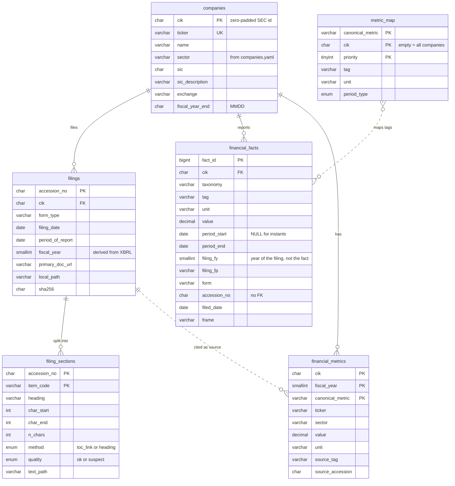
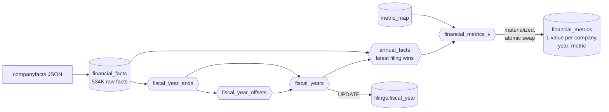

# Financial database: XBRL → MySQL

[← README](../README.md) · [Data acquisition](01-data-acquisition.md) · [Financial database](02-financial-database.md) · [Filing text](03-filing-text.md) · [Retrieval and answers](04-retrieval-and-answers.md) · [Evaluation](05-evaluation.md) · [Findings](findings.md) · [Roadmap](roadmap.md)

How 534,026 raw XBRL facts become one validated value per company, fiscal year and metric.

## Why the raw JSON cannot be queried directly

| Problem in companyfacts | Evidence |
|---|---|
| The same value appears 2–3 times | Every 10-K repeats the previous two years as comparatives: Apple's FY2024 revenue ($391.035B) appears in three filings |
| `fy` describes the **filing**, not the value | Those three copies carry `fy` = 2024, 2025 and 2026 |
| `fy` is sometimes simply wrong | NVIDIA FY2011–FY2014 labelled one year early |
| `frame` is a calendar label | NVIDIA's FY2026 (Feb 2025–Jan 2026) is framed `CY2025` |
| Annual, quarterly, year-to-date and point-in-time values are mixed | 119K annual, 113K quarterly, 98K YTD, 202K instants |
| Many tags for one concept, and one tag with different meanings | Revenue appears under 4+ tags; Chevron's `Revenues` includes other income, ConocoPhillips' does not |

## Schema



| Decision | Reason |
|---|---|
| **CIK is the primary key, not the ticker** | Tickers move between entities (see `XOM` in [Findings](findings.md)) |
| `DECIMAL(30,6)`, never `FLOAT` | Binary floats cannot represent money exactly; JSON is parsed with `Decimal` end to end |
| `period_start` nullable | Balance-sheet items are point-in-time; income items span a period |
| `filing_fy` / `filing_fp` naming | Makes it impossible to mistake the filing's year for the value's year |
| No FK from facts to filings | Most facts come from filings that were not downloaded (10-Qs, older 10-Ks) |
| Natural keys for derived tables | `fact_id` changes on every reload; citations use `(company, tag, period, accession)` |

## Derivation layers

Raw facts are never modified. All rules live in views (`sql/views.sql`); the final table is materialized (`sql/post_load.sql`).



*Cylinders are tables, hexagons are views.*

**1. Fiscal years (`fiscal_year_ends` → `fiscal_year_offsets` → `fiscal_years`)**

```text
fiscal_year = YEAR(year_end − 7 days) + company_offset
```
- The **year-end** of each 10-K is the latest end date of its ~1-year `us-gaap` facts. Cover-page `dei` facts are excluded because their dates fall after year-end.
- **−7 days** handles 52/53-week years: Johnson & Johnson's year ending 1 Jan 2023 is FY2022.
- **`company_offset`** is the *most common* difference between SEC's `fy` and that calendar year, per company. It captures labelling conventions while a few wrong `fy` values are outvoted instead of copied.

**2. One value per year (`annual_facts`)**
- Keeps ~1-year durations (350–380 days, covering 52/53-week years) and year-end instants.
- When a period is reported more than once, **the latest filing wins**, so restatements replace the original figure. SEC applies the same rule when assigning `frame`.
- Keeps `source_accession`: the citation for every number.

**3. Canonical metrics (`metric_map` → `financial_metrics`)**

[`sql/metric_map.csv`](../sql/metric_map.csv) lists the candidate tags for each metric in priority order, plus optional per-company overrides. The highest-priority tag that exists wins, and the chosen tag is recorded in `source_tag`.

| Metric | Tags (priority order) | Statement |
|---|---|---|
| `revenue` | `Revenues` → `RevenueFromContractWithCustomerExcludingAssessedTax` → `…IncludingAssessedTax` → `SalesRevenueNet` (CVX override: contract revenue) | Income |
| `cost_of_revenue` | `CostOfRevenue` → `CostOfGoodsAndServicesSold` | Income |
| `gross_profit` | `GrossProfit` | Income |
| `rnd_expense` | `ResearchAndDevelopmentExpense` → `…ExcludingAcquiredInProcessCost` | Income |
| `operating_income` | `OperatingIncomeLoss` | Income |
| `net_income` | `NetIncomeLoss` → `ProfitLoss` | Income |
| `eps_basic`, `eps_diluted` | `EarningsPerShareBasic`, `EarningsPerShareDiluted` | Income |
| `shares_diluted` | `WeightedAverageNumberOfDilutedSharesOutstanding` | Income |
| `total_assets`, `total_liabilities` | `Assets`, `Liabilities` | Balance sheet |
| `total_equity` | `StockholdersEquity` → `…IncludingPortionAttributableToNoncontrollingInterest` | Balance sheet |
| `cash` | `CashAndCashEquivalentsAtCarryingValue` | Balance sheet |
| `operating_cash_flow` | `NetCashProvidedByUsedInOperatingActivities` | Cash flow |
| `capex` | `PaymentsToAcquirePropertyPlantAndEquipment` → `PaymentsToAcquireProductiveAssets` | Cash flow |

Missing lines stay **NULL**; nothing is estimated (most pharma and energy companies report no gross profit: 7/20 coverage). Derived ratios belong to the deterministic ratio tools (Phase 5).

**4. Materialization.** Querying the stacked views took 2–3 s. `financial_metrics` is rebuilt into a new table and swapped in with a single atomic `RENAME`, so readers never see a missing or half-built table. Its primary key `(cik, fiscal_year, canonical_metric)` also acts as a test: a duplicate value would make the build fail.

## Loaders

| Module | Behaviour |
|---|---|
| `load_manifests.py` | Upserts (`INSERT … AS new ON DUPLICATE KEY UPDATE`) in one transaction · columns are taken from the table definition, so extra CSV columns are ignored with a notice · prunes filings no longer in the manifest |
| `xbrl_loader.py` | Per company: one transaction, delete then re-insert in 5,000-row batches · `Decimal` parsing · field lengths checked against the schema before insert |
| `load_metric_map.py` | Validates the CSV (duplicate priorities, period types, CIK format) · full replace with `DELETE` (not `TRUNCATE`, which commits implicitly) |

## Validation

Documented in [`validation.md`](validation.md). Ten FY2024–FY2026 values for AAPL, AMZN, CVX and COP were compared by hand with the printed statements; all match.

The check found one **semantic** error that a numeric comparison could never catch: Chevron's `Revenues` tag holds *total revenues and other income* (184,432 sales + 3,000 equity-affiliate income + 1,599 other income = 189,031), while ConocoPhillips' `Revenues` is its sales line. Fixed with a per-company override. The technique used to find the correct tag was to read the number off the printed statement, then search `annual_facts` for the tag that holds that exact value.