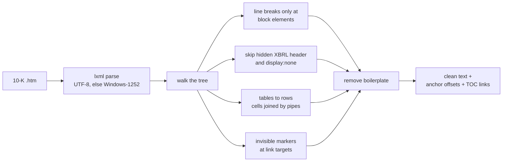
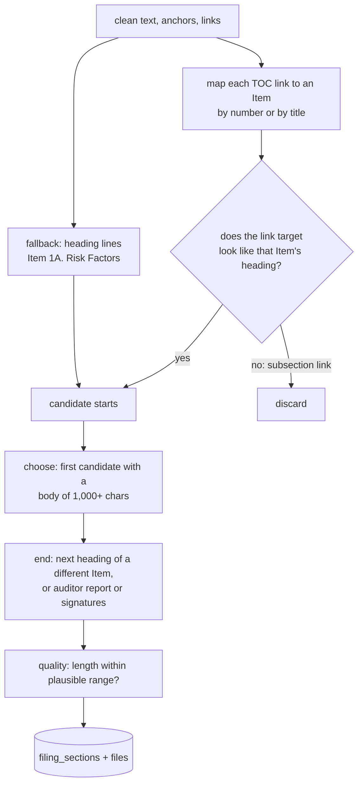

# Filing text: HTML → sections → chunks

How a 10-K HTML document becomes clean text, then Items, then retrievable chunks.

## Why this is hard

10-K HTML is not standardized. Three sample filings broke a naive approach in different ways:

| Filing | Problem |
|---|---|
| Apple | `Item 1A` appears in the table of contents, in cross-references ("Item 1A of this Form 10-K…"), and once as the real heading |
| Microsoft | `Item 1A` repeated as a **running page header** on every page; the heading is split across styled ``s (`RIS` + `K FACTORS`) |
| Chevron | Cross-references are **textually identical** to the real heading; Item 7 is a one-line pointer to a separate *Financial Section* |
| Qualcomm | A linked "Risk Factors Summary" precedes the real Item 1A |
| Intel | No Item headings at all: a cross-reference index maps Items to page ranges |

## Text extraction (`parsing/html_text.py`)

| Rule | Why |
|---|---|
| Line breaks only at block elements (`p`, `div`, `tr`, …) | `get_text("\n")` broke words built from styled spans |
| Tables become `[TABLE]`-delimited rows, cells separated by pipes; lone `$` cells dropped; `(321` + `)` rejoined | Segment figures exist **only** in these tables (they are not in companyfacts) |
| Bare header patterns (`PART II`, `Item 1A`, `Table of Contents`, page numbers) removed when seen 2+ times | A real heading always carries its title |
| Other short lines removed only when repeated 8+ times | A lower threshold deleted real content (energy region names repeat 5–7 times) |
| Private-use marker characters at every link target, converted to offsets after cleanup | Cleanup can delete or move lines without losing where sections start |

## Item splitting (`parsing/section_splitter.py`)

- **Links first, verified.** A table-of-contents link is accepted only if its target text is that Item's heading. This separates Chevron's real heading from identical cross-references and rejects links to subsections ("GENERAL RISK FACTORS", "Environmental Matters").
- **Numbered headings** must be `Item N` followed by nothing or that Item's own title, so `Item 1A of this Form 10-K…` is rejected.
- **Title-only headings must be the whole title.** "Risk Factors" passes; "Risk Factors Summary:" does not. MD&A, with its long, distinctive title, matches as a prefix.
- **First candidate with a real body** skips TOC rows and pointer stubs (Chevron's Item 7). Legitimately short Items ("Item 1B. None.") take the link-verified candidate.
- **Quality flag:** Items 1A and 7 outside 10K–300K / 10K–400K characters are marked `suspect`. Only filings with both `ok` are chunked.

## Results

| | |
|---|---|
| Filings with Items 1A and 7 `ok` | **76 / 80 (95.0%)** |
| Sections stored | 1,784 |
| Average length (ok) | Item 1A ≈ 79K chars, Item 7 ≈ 66K chars |
| Method | Link-verified for most companies; EOG (no usable links) and JNJ FY2023 via text fallback |
| Failures | Intel × 4: cross-reference index format |

Item 1C appears in 62 filings, which matches its regulatory start date: filings for fiscal years ending before 15 Dec 2023 do not have it. The per-section review report, including the line each section ended at, is written to `eval/results/section_parse_report.csv`.

**Tests:** `tests/test_sections.py` (28 cases) reproduces the layouts of Apple, Microsoft, Chevron, Qualcomm and a filing without links, including each regression found during development.

## Chunking (`ingestion/chunker.py`)

Sections from filings with both key Items `ok`, for Items **1, 1A, 1C, 3, 7, 7A**.

| Rule | Why |
|---|---|
| ~350-token target, ~50-token overlap of whole lines | Small enough that five passages fit comfortably in one prompt, large enough to hold a full argument. Tokens are counted with the `bge-base` tokenizer (`chunking.tokenizer`); it is kept only as a counter so chunk boundaries, and therefore chunk IDs and evaluation labels, stay stable when the embedding model changes |
| Split at paragraph lines; sentences only for over-long paragraphs | Chunks start and end at natural boundaries |
| Tables kept whole; large tables split by rows, **header row repeated** on each piece; giant rows split by words | Numbers never lose their column labels |
| A heading never ends a chunk | It moves to the next chunk, with its content |
| Runs of 3+ short lines treated as lists, not headings | Otherwise list content was never emitted |
| **Context header** embedded with each chunk: `AMD 10-K FY2025 \| Item 1A Risk Factors \| Operational and Technology Risks` | A chunk about "USG licensing requirements" still carries its company, year and section |
| Stable IDs: `<accession>_<item>_<seq>` | Rebuilds never renumber anything |

**Result:** 11,540 chunks (Item 1A 4,086 · Item 7 3,842 · Item 1 2,932 · 7A 238 · 1C 225 · 3 217); median 319 tokens, p95 369, max 458. **Tests:** `tests/test_chunker.py` (10 cases), including no content lost, no duplicate overlap-only chunks, and giant table rows.