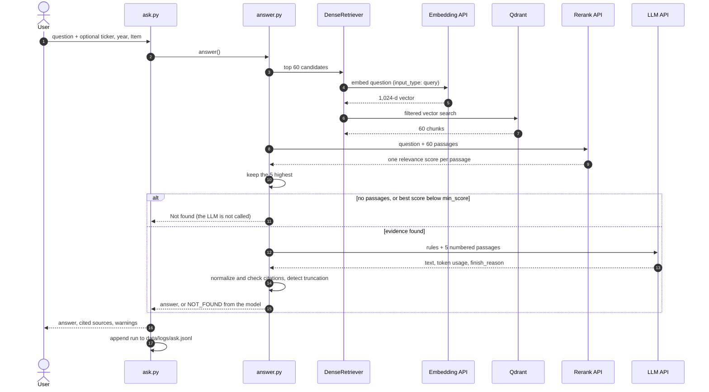

# Retrieval and answers

[← README](../README.md) · [Data acquisition](01-data-acquisition.md) · [Financial database](02-financial-database.md) · [Filing text](03-filing-text.md) · [Retrieval and answers](04-retrieval-and-answers.md) · [Evaluation](05-evaluation.md) · [Findings](findings.md) · [Roadmap](roadmap.md)

How a question becomes five passages, and how five passages become a cited answer or a refusal.

Every model in this path is reached through a hosted API. No model name appears in `src/`: URLs, model IDs and the names of the API-key variables all come from `configs/`.

## Query flow

## Embeddings (`retrieval/embedder.py`, `ingestion/embed_chunks.py`)

| | |
|---|---|
| Model | Set in `configs/retrieval.yaml` (`embedding.model`); currently an 8B hosted embedding model, 1,024 dimensions requested out of a native 4,096 |
| Asymmetric use | Chunks are embedded with `input_type: passage`, questions with `input_type: query`. Mixing them lowers retrieval quality |
| Normalization | Vectors are L2-normalized in code, so cosine similarity is a dot product |
| Cache | Each vector is stored under `sha1(model + dimensions + header + text)`. Re-running embeds only new or changed chunks |
| Checkpoints | The cache is saved every 20 batches, so a rate limit or network failure loses a few seconds of work and a re-run resumes |
| Parallelism | `embedding.workers` requests at a time. 4,884 chunks took 507 s with 2 workers (about 10 chunks/s) |
| Content-safety refusals | The API can refuse a whole batch because of one passage. The batch is split until that passage is isolated, and that chunk is embedded from its header only (company, year, Item). 2 of 11,540 chunks were refused |

The project started with a local model (`bge-base-en-v1.5`, 768 dimensions, PyTorch on Apple-Silicon GPU). Replacing it was the largest single improvement measured; see [Evaluation](05-evaluation.md).

## Vector store (`storage/vector_store.py`, `ingestion/index_chunks.py`)

- **Qdrant 1.18.2** in Docker; client pinned to the matching version.
- Collection `sec_chunks`, cosine distance, **payload indexes** on `ticker`, `fiscal_year`, `item_code`, `accession_no`.
- **Point IDs = `uuid5(chunk_id)`**: re-indexing replaces points instead of duplicating them; points for chunks that no longer exist are deleted.
- **Filters are normalized** (`"amd"` → `AMD`, `"2025"` → `2025`) so tool calls with slightly different formats do not silently return nothing.
- The collection is recreated automatically when the vector size changes.
- Verified against brute-force NumPy search: identical chunks and scores.

## Reranking (`retrieval/reranker.py`)

An embedding model reads the question and the passage separately and compares two vectors. A cross-encoder reads them together and outputs one relevance score. That is more accurate and much slower, so it only re-sorts the top 60 chunks from dense search (`rerank.candidates`).

| | |
|---|---|
| Input | Question plus `header + text` of each candidate, in one request |
| Output | One logit per passage, passed through a sigmoid to give a 0–1 score |
| Cache | Scores are cached per (question, chunk) within a process |
| Retries | 429 and 5xx responses are retried with exponential backoff |
| Content-safety refusals | Same batch-splitting as the embedder. An isolated refused passage scores 0, is ranked last, and is counted; 5–6 passages per evaluation run |

`retrieval/factory.py` builds a retriever by name. Two exist: `dense` (vector search only) and `rerank` (dense candidates, re-sorted). `answering.retriever` in the config chooses which one `ask` uses.

## LLM layer (`llm/base.py`)

One class covers every provider that offers an **OpenAI-compatible** `/chat/completions` API. The `openai` package is used only as the HTTP client; requests go to the configured `base_url`, never to OpenAI.

| Backend | Model | Type |
|---|---|---|
| `groq` (default) | `openai/gpt-oss-120b` | Open-weight |
| `gemini` | `gemini-3.8-flash` | Closed |
| `nvidia` | `nvidia/nemotron-3-super-120b-a12b` | Open-weight |

- **Selection order:** `--backend` flag → `LLM_BACKEND` env var → `default_backend` in `configs/llm.yaml`. The chosen backend and its source are printed on every run.
- **Retries:** 429 and 5xx responses are retried with exponential backoff by the client.
- **Truncation detection:** `finish_reason == "length"` is reported. Reasoning models spend part of `max_tokens` on hidden reasoning, so the limit is 2,000.
- **`temperature: 0`** for reproducibility (hosted models are still not perfectly deterministic).

## Answer generation (`rag/answer.py`, `rag/ask.py`)

| Safeguard | Implementation |
|---|---|
| Answers only from evidence | The model sees only the numbered passages, under rules forbidding outside knowledge and new calculations |
| Citations required and **checked** | Every sentence must end with `[n]`. Code normalizes model-specific styles (`【1】`, `【4†L5-L9】`, `[1, 2]`), flags citations to passages that were not shown, and flags factual sentences without a citation. The sentence splitter does not break on abbreviations such as "U.S." |
| Year attribution | Passages from different years must be attributed (*"In its FY2024 10-K, AMD…"*) |
| Retrieved text is untrusted | Passages are delimited, and instructions inside them are to be ignored |
| Traceability | `[n]` → chunk ID → accession number → Item → SEC URL |
| Observability | Every run (question, filters, retriever, chunk IDs, scores, answer, tokens, latency, flags) is appended to `data/logs/ask.jsonl` |

## Refusal: two layers

| Layer | When | What it catches |
|---|---|---|
| **Score gate** | Before any LLM call: no passages, or top-1 score below `answering.min_score` for the active retriever | Questions with nothing related in the corpus. Saves the LLM call |
| **Model refusal** | The model must reply `NOT_FOUND: <reason>` when the passages do not answer the question | Questions that retrieve related-looking passages: a company or year that is not indexed, a false premise, a request for advice |

Each retriever has its own score scale (cosine similarity for `dense`, a sigmoid relevance score for `rerank`), so the threshold is stored per retriever. How the thresholds were chosen, and why the gate alone is weak, is in [Evaluation](05-evaluation.md#refusal-threshold).

**Tests:** `tests/test_answer.py` (fake retriever and fake LLM: citation checks, both refusal paths, filters, truncation, prompt structure) and `tests/test_reranker.py` (candidate pool, re-sorting, `k`).