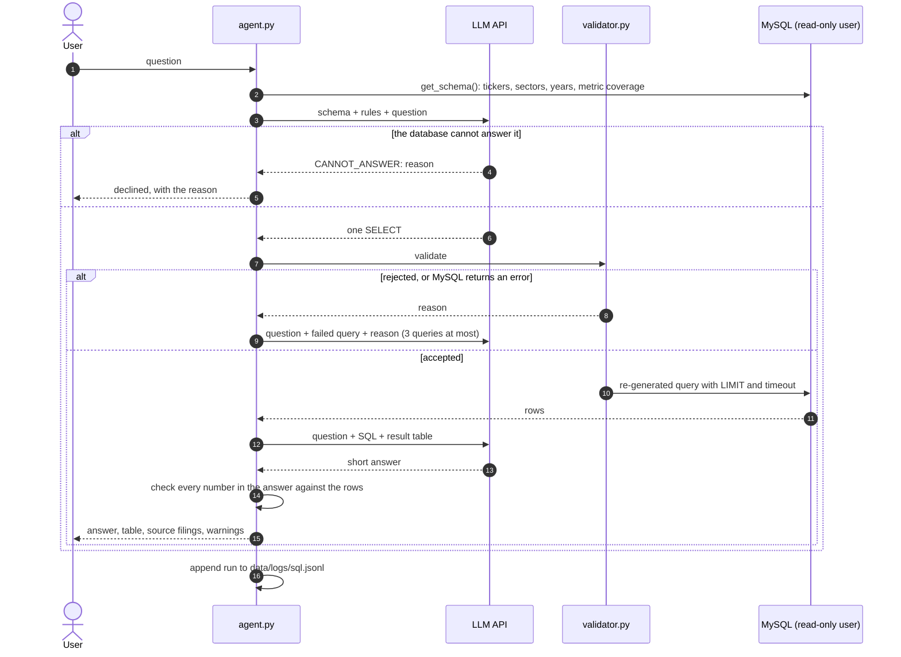

# SQL Analyst

How a numeric question in English becomes a safe MySQL query, a result table, and an answer whose every number comes from a database row.

## Why a separate component

Retrieval is the wrong tool for figures. Numbers in filing text are spread across tables, mixed across years, and easy for a model to misread or miscompute. The database already holds one validated value per company, fiscal year and metric (see [Financial database](02-financial-database.md)), so numeric questions are answered from it, and all arithmetic is done by MySQL, never by the model.

```text
$ python -m sectra.analyst.agent "Which companies grew revenue by more than 20% in fiscal 2025?" --show-sql

ticker  fiscal_year  growth_pct  source_accession
AMD     2025         34.34       0000002488-26-000018
LLY     2025         44.7        0000059478-26-000013
NVDA    2025         114.2       0001045810-26-000021
META    2025         22.17       0001628280-26-003942
AVGO    2025         23.87       0001730168-25-000121

--- query 1
SELECT fm2025.ticker, fm2025.fiscal_year, ROUND(100 * (fm2025.value - fm2024.value) / fm2024.value, 2) AS growth_pct,
       fm2025.source_accession
FROM financial_metrics AS fm2025 JOIN financial_metrics AS fm2024
  ON fm2025.cik = fm2024.cik AND fm2025.fiscal_year = fm2024.fiscal_year + 1
WHERE fm2025.canonical_metric = 'revenue' AND fm2024.canonical_metric = 'revenue' AND fm2025.fiscal_year = 2025
  AND ROUND(100 * (fm2025.value - fm2024.value) / fm2024.value, 2) > 20 LIMIT 200
```

## Flow



## Safety: two independent layers

| Layer | Enforced by | What it does |
|---|---|---|
| **Read-only user** (`storage/setup_reader.py`, `make db-role`) | MySQL | A separate user with `SELECT` on three tables and nothing else. A write, or a read of any other table, is denied by the database even if every other check fails |
| **Validator** (`analyst/validator.py`) | Code, before the query is sent | Rejects the query with a readable reason, which is returned to the model so it can correct itself |

Validator rules:

- The query is parsed with `sqlglot` in the MySQL dialect; nothing is matched with regular expressions.
- Exactly one statement, and it is a `SELECT` (`WITH` and `UNION` are allowed).
- No writes, no `SELECT … INTO`, no locking clauses, no user or system variables.
- It must read at least one table, only from the allowlist (`financial_metrics`, `companies`, `filings`), never qualified with a database name. The raw `financial_facts` table is excluded: its duplicate values and misleading `fy` labels would produce wrong answers.
- Functions the parser does not recognise are rejected, which covers `SLEEP`, `BENCHMARK`, `LOAD_FILE` and `GET_LOCK` without a long denylist; so are functions that describe the server (`VERSION`, `USER`, `DATABASE`).
- A `LIMIT` is added, or lowered to `max_rows` (200).
- **The query that runs is the one re-generated from the parse tree.** Comments are dropped, including MySQL's executable `/*! … */` form.

A statement timeout (`MAX_EXECUTION_TIME`, 5 s) is set on the connection. `tests/test_sql_validator.py` holds 32 queries that must be rejected and the shapes that must pass.

## What the model is told (`analyst/tools.py`)

`get_schema()` builds the schema text from two sources:

- **Written by hand:** the columns of the three tables, and the facts that trip a model up: each metric is a row and not a column, a missing metric has no row, values are in full units, fiscal years differ between companies.
- **Read from the database on every run:** sectors, tickers with company names, the range of fiscal years, the default year (the latest one every company has), and for each of the 15 metrics how many companies report it.

The coverage counts are what let the model say "not reported" instead of treating a missing row as zero: gross profit is reported by 7 of 20 companies.

The prompt rules require one `SELECT` or `CANNOT_ANSWER`, all calculation in SQL (margins as a self-join, growth as a join on the previous year), `ticker`, `fiscal_year` and `source_accession` in every result, the default year when none is named, and only the years the question asks about.

## The answer and the number check

A second call writes a short answer from the result table only, with the rule to copy numbers exactly. Code then checks **every number in the answer** against the rows and the question; anything else is flagged. A number matches a row value if the row value, rounded to the decimals written, equals it, so 63.9 matches 63.89. This is the numeric counterpart of the citation check in the text pipeline: a calculation done by the model would appear as a number that is in no row.

## Evaluation

`eval/datasets/sql_qa.jsonl`: 46 questions with gold SQL.

| Type | Count | Example |
|---|---|---|
| lookup | 10 | Apple's revenue in fiscal 2025; one question names no year |
| ranking | 6 | Which three companies had the highest revenue in fiscal 2025? |
| ratio | 8 | Which companies had net income above 25% of revenue? |
| growth | 6 | Which energy companies had lower revenue in fiscal 2025 than in 2024? |
| aggregate | 6 | Average net income per sector |
| not reported | 3 | Pfizer's gross profit (no such row exists) |
| cannot answer | 7 | Stock price, iPhone revenue, quarterly revenue, a company that is not indexed, a forecast, headcount, advice |

**Scoring is by result, not by SQL text** (execution accuracy). For questions with data, the agent's rows must hold the same companies, sectors and years as the gold rows with the same values, and no extra rows; values are compared within rounding and across unit scales, so billions against raw dollars still match. For the 10 questions with no data, the agent passes if it declines or returns no rows and fails if it returns any value.

### Results (`gpt-oss-120b`)

| Run | Accuracy | Notes |
|---|---|---|
| First run | 42 / 46 (91.3%) | No query needed a retry. All 10 no-data questions passed |
| First run, one gold query corrected | 43 / 46 (93.5%) | One failure was a flaw in the gold query, not in the agent |
| After three prompt fixes | 46 / 46 (100%) | The fixes were written after seeing the failures, so this run is tuned on the questions it is tested on |

The first-run results are kept in `eval/results/sql_eval_groq_run1.json`.

| First-run failure | Cause | Fix |
|---|---|---|
| Chevron's total assets returned ConocoPhillips' | The schema listed tickers without company names, and the model guessed `COP` | Company names added next to tickers |
| "What is Qualcomm's net income?" returned every year since 2009 | The default year was stated in the schema but no rule said to use it | Rule added |
| NVIDIA's growth "in fiscal 2025" returned growth for every year | The model omitted the year filter | Rule added: return only the years asked about |
| Energy companies with lower revenue | The agent's result was right; the gold query demanded a growth percentage the question never asked for | Gold query corrected |

Two answers were flagged for a number that is not in the rows. Both were false alarms from sign handling: the row held −3.9 and the answer said revenue "fell by 3.9%". The check now compares absolute values.

### What this does not show

- **46 questions written by the same person who wrote the prompt**, on a schema with one fact table. This is far easier than general text-to-SQL.
- **The 100% figure is not a held-out result.** The honest first-run number is 93.5%.
- **One generator.** Other backends have not been run on this set.
- **No adversarial questions through the agent.** The validator is tested with attack queries directly; prompt-injection attempts through the question are part of the red-team work planned later.

## Running it

```bash
make db-role                                             # create the read-only user (also part of `make db`)
python -m sectra.analyst.tools                           # print the schema text the model sees
python -m sectra.analyst.agent "…" --show-sql            # ask a question
python -m sectra.evaluation.sql_eval --check-gold        # run only the gold queries
make sql-eval                                            # score the agent on all 46 questions
```

Settings are in `configs/sql.yaml`: the table allowlist, `max_rows`, the timeout, and the names of the environment variables holding the read-only user's credentials.