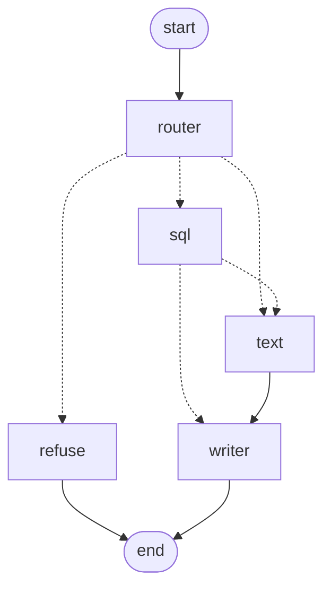

# Research graph

One entry point for numeric, narrative and hybrid questions: a router decides where a question goes, the corpus is checked before anything is searched, and a single writer answers from a result table, filing passages, or both.

```text
$ python -m sectra.agents.graph "Which healthcare company grew revenue fastest in fiscal 2025, and what drove that growth?"

Eli Lilly grew revenue fastest, at 44.7 % year-over-year in fiscal 2025 [T].
Revenue rose mainly because volume increased sharply, especially for Mounjaro and Zepbound; the higher
volume was partially offset by lower realized prices [1][2].

[T] ticker  fiscal_year  revenue_growth_pct  source_accession
    LLY     2025         44.7                0000059478-26-000013

Passages:
 *[1] LLY 10-K FY2025 | Item 7 Management's Discussion and Analysis
 *[2] LLY 10-K FY2025 | Item 7 Management's Discussion and Analysis | Other Factors

Steps:
  - router: both
  - sql: 1 rows
  - text: 5 passages (LLY FY2025)
  - writer: answer written
```

(Output abridged.) The question names no company. The SQL step found it, and the text search was then filtered to that company and year.

## The graph

Built with LangGraph (`agents/graph.py`). The diagram is generated from the code with `python -m sectra.agents.graph --diagram`.



| Path | When |
|---|---|
| router → refuse | The corpus cannot answer: company or year not indexed, advice, forecast, off-topic |
| router → sql → writer | A figure the database holds, or one computed from it |
| router → text → writer | An explanation, a risk, a description, or a figure that exists only in filing text |
| router → sql → text → writer | A figure and an explanation |

How LangGraph is used:

- **State.** One dictionary (`ResearchState`) shared by all nodes. A node returns only the keys it changes. The `trace` key has a reducer (`operator.add`), so each node's step line is appended instead of overwriting the previous one.
- **Nodes.** Five plain functions in `agents/nodes.py`. None of them imports LangGraph, so they are tested directly with a scripted LLM, a fake retriever and SQLite.
- **Edges.** `text → writer` is fixed. The edges out of `router` and `sql` are conditional: a small function reads the state and names the next node.

## Router (`agents/router.py`)

Two steps, the second with no LLM.

**1. `route()`: one LLM call.** The model is told what each source holds (the 15 metric names for SQL; the narrative sections for text) and returns JSON: the route (`sql`, `text`, `both`, `none`), the companies and fiscal years the question mentions, and for a hybrid question the numeric part and the narrative part as two standalone questions. A reply that is not valid JSON is retried once, then the question falls back to a text search.

A figure that is not one of the 15 metrics, such as segment revenue or headcount, is routed to `text`, because it exists only in the filings.

**2. `check_corpus()`: deterministic.** A catalog is read from the database: the companies, the fiscal years with filing text, and the years with metrics.

- **Company names are matched to tickers in code**, against SEC names and an alias list in `configs/agents.yaml`. A name that matches nothing is not guessed.
- **Questions the corpus cannot answer are refused with the reason**, before any retrieval or SQL: a company that is not indexed, a year with no filing, a year outside the metrics.
- **A hybrid question is reduced to one side** when only one side is possible (Intel has metrics but no filing text).
- **When no year is named, the text search uses the latest filing**, not all four near-identical years.

## Nodes (`agents/nodes.py`)

| Node | What it does |
|---|---|
| `router` | `route()` then `check_corpus()` |
| `refuse` | Returns the refusal and its reason |
| `sql` | Runs the [SQL Analyst](06-sql-analyst.md) and keeps the query, rows and source filings; it does not write an answer |
| `text` | One filtered search per company (at most three), so one company cannot crowd out another. If the question names no company, the companies and years come from the SQL rows. A search whose best score is below `min_score` contributes nothing |
| `writer` | One LLM call over the result table and the numbered passages, followed by the checks |

**The writer** cites `[T]` for the result table and `[n]` for passages. It takes figures from the table when the table has them, uses passages for explanations, and replies `NOT_FOUND` when the evidence does not answer the question. If there is no table and no passage, it is not called.

**Checks on every answer:**

- Each bullet or paragraph must end with a source; `[T]` counts as one. Citations to passages that were not shown are flagged.
- Every number must appear in the table, the passages or the question.
- A reply cut off at the token limit is flagged.

## Evaluation

`python -m sectra.evaluation.routing_eval --retrieval --end-to-end`, on 158 questions whose right handling is already known.

### Routing

| Group | Questions | Correct | Notes |
|---|---|---|---|
| Numeric (`sql_qa.jsonl`) | 46 | 40 (87.0%) | Six sector-level rankings were sent to `both` instead of `sql` |
| Narrative (paraphrased retrieval set) | 82 | 79 (96.3%) | Two sent to `sql`, one refused |
| Hybrid (`hybrid_qa.jsonl`) | 15 | 15 (100%) | |
| Unanswerable, recognisable by a router | 8 | 8 (100%) | All refused |
| **All** | **151** | **142 (94.0%)** | |

- **Answerable questions wrongly refused: 1 of 138.** A question about "MPLX", a Marathon Petroleum subsidiary, was read as a company that is not indexed.
- **Company extracted correctly: 94 of 94. Fiscal year for the text search correct: 81 of 81.**
- No router reply failed to parse.

### Retrieval with the router's filters

The 82 paraphrased questions from the [retrieval evaluation](05-evaluation.md), searched with the ticker and year the router extracted:

| Filters | Recall@1 | Recall@5 | Recall@10 |
|---|---|---|---|
| None (open search) | 84.1% | 95.1% | 96.3% |
| **From the router** | **82.9%** | **98.8%** | **100%** |
| From the labels (upper bound) | 86.6% | 98.8% | 100% |

The router's filters reach the same Recall@5 as perfect filters.

### Refusing what cannot be answered

All 15 unanswerable questions were refused end to end. In Phase 4, the retrieval-score gate alone stopped 5 of 15.

| Layer | Stopped | Kind of question |
|---|---|---|
| Router and corpus check | 8 | Company or year not indexed, advice, forecast, personal information |
| Evidence check (score below `min_score`) | 4 | Odd questions about indexed companies, such as cafeteria menus |
| Writer (`NOT_FOUND`) | 3 | False premises, such as "Apple's acquisition of Netflix" |

Each layer catches a kind of question the others cannot.

### After the evaluation

Two changes were made in response to the failures, and have **not** been re-measured:

- A rule in the router prompt: choose `both` only when the question explicitly asks for an explanation or description; a ranking or total of figures alone is `sql`.
- An alias `mplx → MPC`. The general weakness remains: a subsidiary or brand name that the catalog does not know is refused.

### What this does not show

- **The hybrid questions and the relabelled numeric questions were written alongside the router prompt.** 15 of 15 on hybrid is an easy test.
- **15 unanswerable questions.** The result shows the three layers work on these kinds of question, not that every false premise is caught.
- **Answer quality is not measured.** Routing, retrieval and refusal are; whether the written answers are faithful to their evidence is still the open item from Phase 4.
- **One generator**, and no adversarial questions.

## Running it

```bash
python -m sectra.agents.graph "…" --show-sql --show-passages
python -m sectra.agents.router "…"                # the routing decision only
python -m sectra.agents.graph --diagram           # the graph as Mermaid
make routing-eval
```

Every run is appended to `data/logs/graph.jsonl` with the route, SQL, chunk IDs, answer, checks, step trace and token usage.